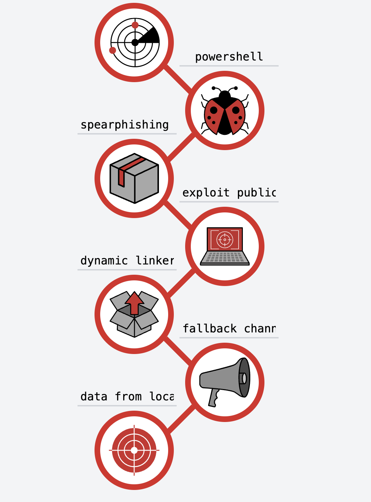

## 1. 개요 

> 6개 항목을 각 단계에 맞게 매칭하기

- exploit public-facing application
- data from local system
- powershell
- dynamic linker hijacking
- spearphishing attachment
- fallback channels

---

## 2. 풀이

| 단계                           | 항목                                  | 이유                                  |
| ---------------------------- | ----------------------------------- | ----------------------------------- |
| **1. Weaponization**         | `powershell`                        | PowerShell 스크립트로 페이로드를 제작하고 준비하는 단계 |
| **2. Delivery**              | `spearphishing attachment`          | 악성 첨부파일이 담긴 스피어피싱 메일로 페이로드 전달       |
| **3. Exploitation**          | `exploit public-facing application` | 외부에 노출된 애플리케이션의 취약점을 악용해 코드 실행      |
| **4. Installation**          | `dynamic linker hijacking`          | 동적 링커를 가로채 악성 라이브러리를 로드시켜 지속성 확보    |
| **5. Command & Control**     | `fallback channels`                 | 기본 C2 채널이 막혔을 때를 대비한 대체 통신 채널       |
| **6. Actions on Objectives** | `data from local system`            | 로컬 시스템에서 데이터를 수집해 유출하는 최종 목표        |

##### 답: `THM{7HR347_1N73L_12_4w35om3}`

