## 1. Splunk Components

### 1) 구성 요소

> Splunk는 세 가지 핵심 컴포넌트로 구성되며, 이들이 협력하여 데이터 수집, 처리, 분석을 수행합니다.

| 종류        | 역할                                                            | 기능                                                                                                |
| ----------- | --------------------------------------------------------------- | --------------------------------------------------------------------------------------------------- |
| Forwarder   | 모니터링 대상 엔드 포인트에 설치되는 경량 에이전트              | 에이전트에 수집한 데이터를 Indexer로 전송                                                           |
| Indexer     | 포워더로부터 받은 데이터를 파싱, 정규화, 저장하는 핵심 컴포넌트 | 데이터를 카테고리별로 분류<br>데이터를 필드-값 쌍 형태로 파싱<br>처리된 데이터를 이벤트 형태로 저장 |
| Search Head | 사용자가 직접 데이터를 검색하고 분석하는 인터페이스             | SPL을 사용하여 인덱싱되니 로그 검색<br>검색 결과를 시각화한 형태로 반환                             |

> 데이터 흐름 요약

`[로그 소스] → Forwarder (수집) → Indexer (파싱·저장) → Search Head (검색·시각화)`

---

## 2. Splunk 홈 화면 구성

> 화면 최상단에 위차한 메뉴 바로, 다음 기능을 제공합니다.

### 1) 상단 바


| 메뉴             | 기능                                 |
| ---------------- | ------------------------------------ |
| Messages(메세지) | 시스템 알림 및 메시지 확인           |
| Settings(설정)   | Splunk 인스턴스 설정 구성            |
| Activity(작업)   | 검색 작업 및 프로세스 진행 상황 확인 |
| Help(도움말)     | 튜토리얼 및 문서 열람                |
| Find(찾기)       | 앱 전체 검색                         |

### 2) 앱

> 현재 Splunk 인스턴스에 **설치된 앱 목록** 표시

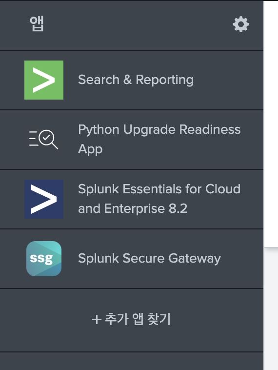

### 3) 탐색 패널

> 빠른 작업을 위한 **퀵 링크** 모음

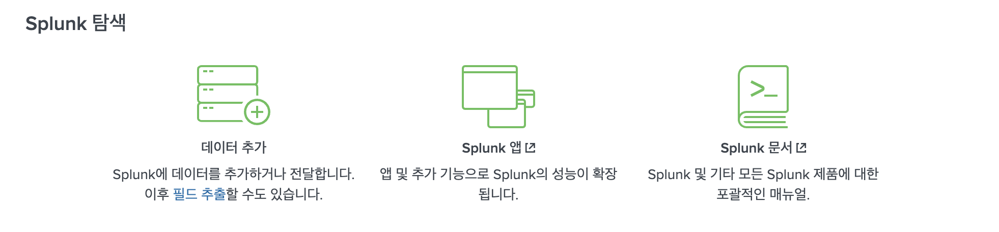

### 4) 홈 대시보드

> Splunk 접속 시 가장 먼저 보이는 모니터링 화면

- 데이터 현황을 한눈에 파악 가능

> 홈 대시화면 생성 작업 gif

    https://assets.tryhackme.com/additional/splunk-overview/splunk-add-dashboard.gif

### 5) 문제

Q. In the Add Data tab, which option is used to collect data from files and ports?

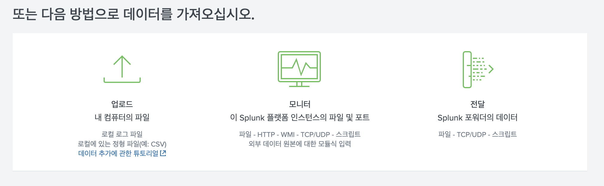

#### 답: Monitor

Splunk의 Add Data 탭에는 보통 세 가지 옵션이 있어요:

| 옵션        | 설명                                                                        |
| ----------- | --------------------------------------------------------------------------- |
| **Upload**  | 로컬 파일을 직접 업로드해서 한 번만 인덱싱                                  |
| **Monitor** | **파일, 디렉토리, 포트, 스크립트 등을 지속적으로 모니터링하며 데이터 수집** |
| **Forward** | Forwarder로부터 데이터를 받아서 수집                                        |

파일(Files)과 포트(Ports)에서 데이터를 수집하는 옵션은 Monitor입니다.

---

## 3. Splunk 데이터 업로드 실습

> 정리

- 앞서 Splunk는 모든 종류의 데이터 수집이 가능하다.
- 데이터 추가 시 -> 개별 이벤트(Events) 단위로 처리, 변환한다.

### 1) 실습 과정

> 1. VPN_logs 파일 다운로드

> 2. Splunk에 업로드 (5단계 wizard 따라가기)

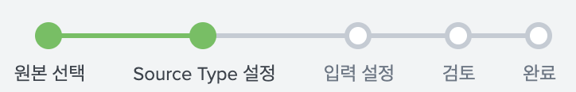

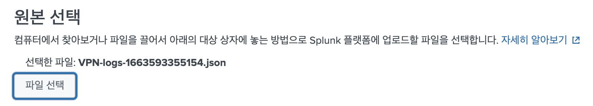

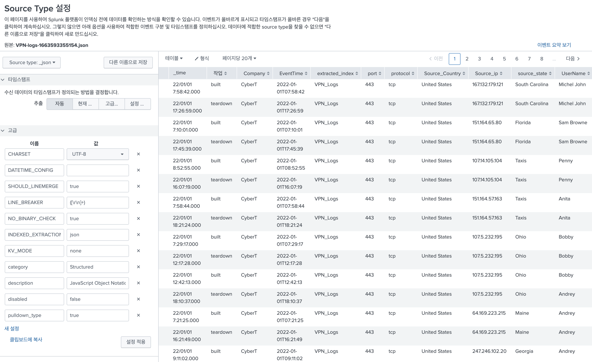

- 역할: 이 데이터가 어떤 형식인지 Splunk한테 알려주는 단계 - 데이터 형식 지정

- 기능
  - SourceType 변경
  - 타임스탬프 수동 설정
  - 고급 설정
    - `LINE_BREAKER` → 줄 구분 방식 변경
    - `SHOULD_LINEMERGE` → 여러 줄을 하나의 이벤트로 합칠지 여부
    - `CHARSET` → 인코딩 변경 (한글 깨질 때 등)

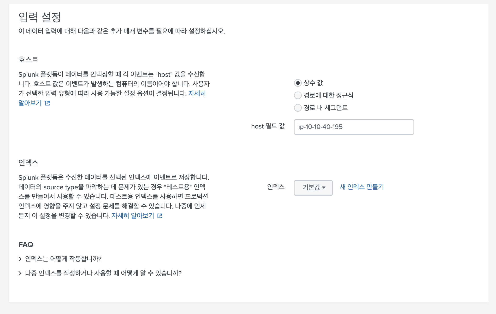

- 역할: 이 데이터를 어디에, 누구 것으로 저장할지 저장하는 단계
  - 호스트 설정
    - 이 데이터가 어느 컴퓨터에서 온 건지 태그를 붙이는 것

  - 인덱스 설정
    - 데이터를 어느 창고에 저장할지 지정하는 것
    - 인덱스 분리하면 원하는 데이터를 좀 더 손쉽게 검색 가능

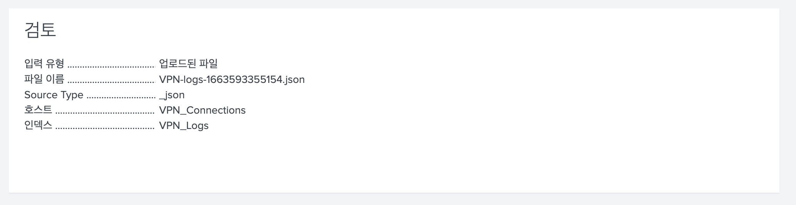

- 역할: 설정한 Splunk 다시 한 번 확인

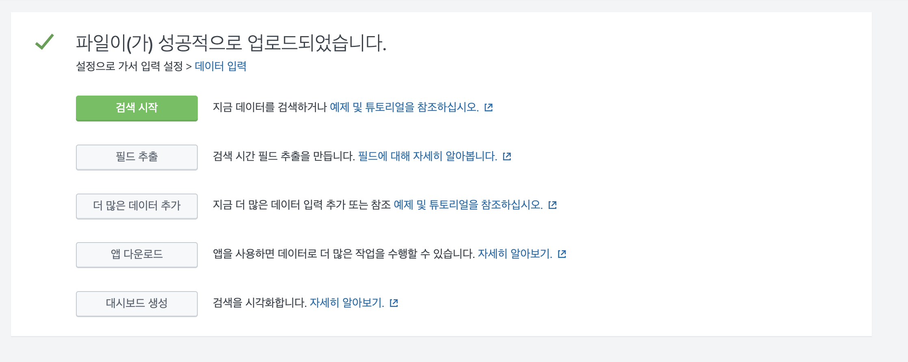

#### Splunk 데이터 저장 동작 원리

```
원본 데이터 (VPN_logs.json)
        ↓
   [태그 부착]
   host = ip-10-10-40-195   ← "어디서 왔냐"
   source = VPN_logs.json   ← "파일 이름이 뭐냐"
   sourcetype = _json        ← "형식이 뭐냐"
        ↓
   [저장 공간 지정]
   index = VPN_Logs          ← "어느 창고에 넣냐"
        ↓
   이벤트 단위로 쪼개서 저장
```

### 2) 검색하기

```
index=VPN_Logs
| stats count
```

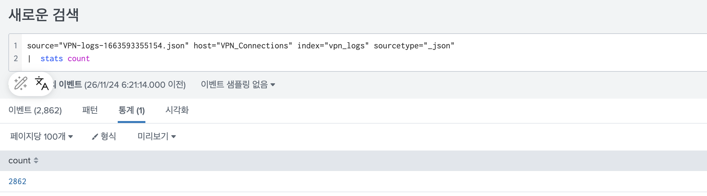

```
index=VPN_Logs
| spath
| search UserName="Maleena"
| stats count
```

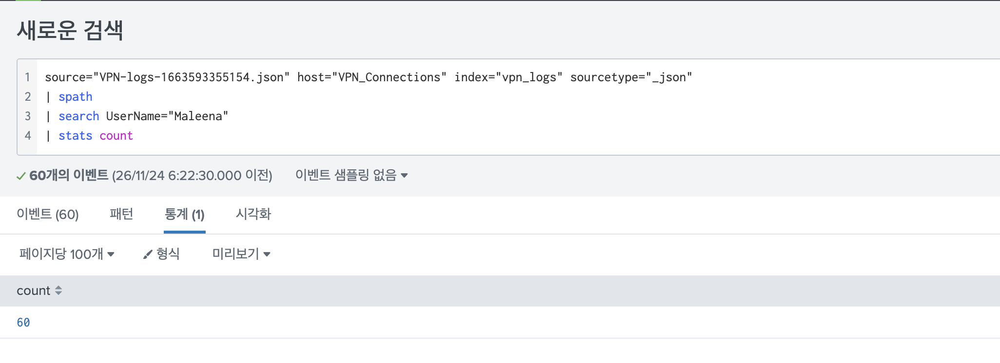

```splunk
index=VPN_Logs
| spath
| search Source_ip="107.14.182.38"
| stats values(UserName) as UserName count
```

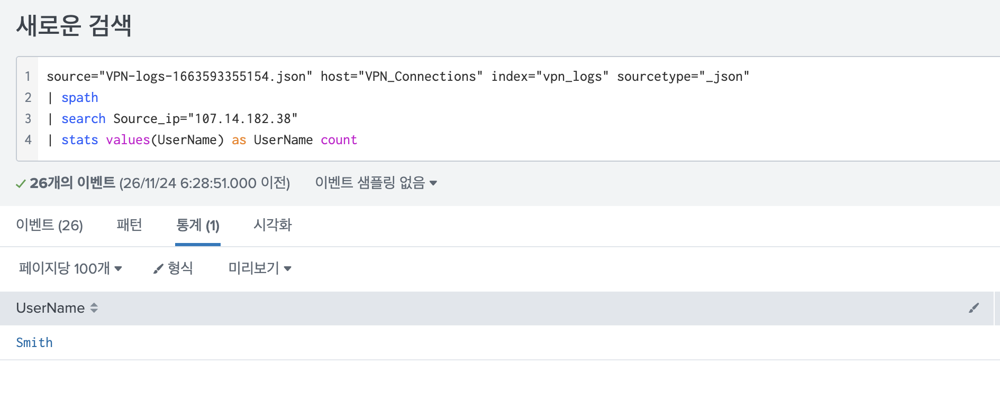

```
index=VPN_Logs
| spath
| search Source_Country!="France"
| stats count
```

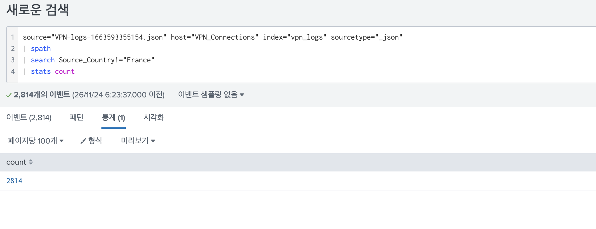

```
index=VPN_Logs
| spath
| search Source_ip="107.3.206.58"
| stats count
```

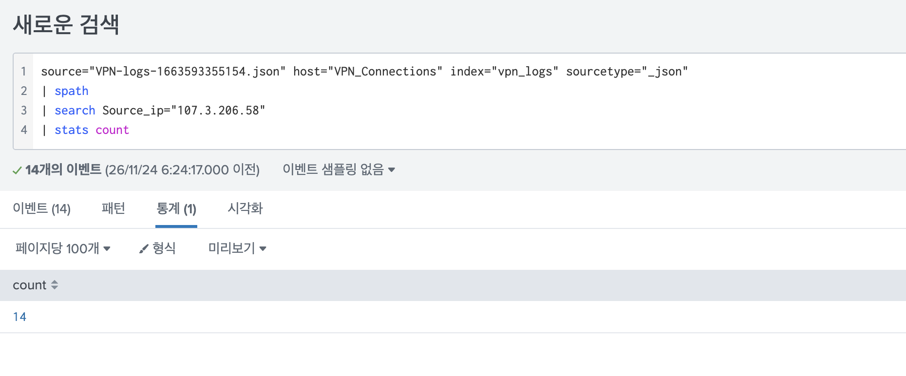

### 3) 문제

#### Q. Upload the data attached to this task and create an index "VPN_Logs". How many events are present in the log file?

##### 답: 2862

#### Q: How many log events are captured by the user **Maleena**?

##### 답: 60

#### Q. What is the username associated with IP 107.14.182.38?

##### 답: Smith

#### Q. What is the number of events that originated from all countries except France?

##### 답: 2814

#### Q. How many VPN events were associated with the IP 107.3.206.58?

##### 답: 14
