## 1. ELK(Elastic Stack)

여러 오픈소스 컴포넌트를 묶은 데이터 수집, 저장, 검색, 시각화 플랫폼으로 원래는 대용량 데이터 분석용이었지만 현재 많은 SOC 팀이 SIEM 대용으로 활용하고 있습니다.

### 1) 컴포넌트 종류

> 데이터 흐름

```
Beats (엔드포인트 수집)
    ↓
Logstash (파싱·정규화)
    ↓
Elasticsearch (저장·검색·분석)
    ↓
Kibana (시각화·대시보드)
```

| 컴포넌트          | 역할                                                                        |
| ------------- | ------------------------------------------------------------------------- |
| Beats         | (엔드포인트 수집) 엔드포인트에 설치하는 경량 에이전트. 데이터를 Elasticsearch로 전송                    |
| Logstash      | (파싱, 정규화) <br>다양한 소스에서 데이터를 수집(INPUT) → 필터링/정규화(FILTER) → 목적지로 전송(OUTPUT) |
| Elasticsearch | (저장, 검색, 분석) JSON 문서 저장·검색·분석 엔진. RESTful API 제공                          |
| Kibana        | (시각화, 대시보드) 웹 기반 시각화 도구. 대시보드·차트·인포그래픽 생성                                 |

### 2) 문제

#### Q. Logstash is used to visualize the data. (yay / nay)  

##### 답: nay

데이터 시각화는 Kibana입니다.

#### Q. Elasticsearch supports all data formats apart from JSON. (yay / nay)

##### 답: nay

Elasticsearch는 JSON 형식 문서를 저장·검색하는 엔진입니다. 즉 JSON을 제외하는 게 아니라 JSON을 기본으로 사용

Logstash는 다양한 소스에서 데이터를 수집해 JSON 포함 여러 포맷을 처리합니다. syslog, CSV, XML, 플레인 텍스트 등 다양한 형식을 지원


## 2. 실습

> 1. Kibana 접속

| 항목       | 정보           |
| -------- | ------------ |
| Username | `Analyst`    |
| Password | `analyst123` |

> 2. VPN 로그 설정

1. 데이터 소스 선택 - Discover 메뉴에서 `vpn_connections` 선택
2. 시간 범위 설정 - 우측 상단 시간 필터 → Absolute 모드로 변경

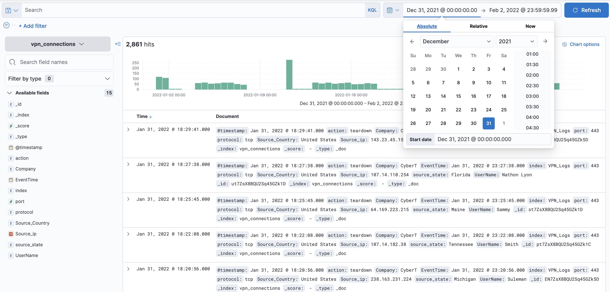

## 3. Discover 탭

> SOC 분석가가 가장 많은 시간을 보내는 곳으로, 수집된 로그 탐색, 이상징후 조사, 필터 적용 등을 수행

### 1) Index Pattern

> 로그 소스마다 각각 별도 인덱스 패턴으로 정규화

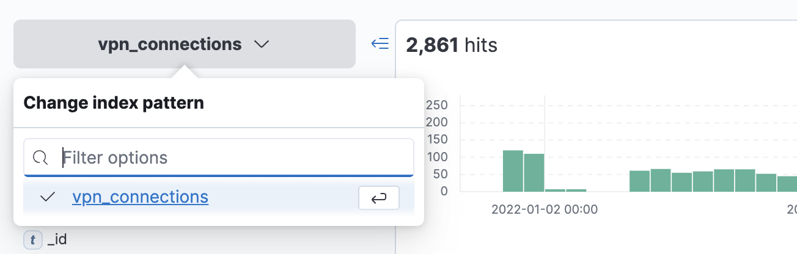


### 2) Fields Pane

> 해당 필드의 발생 비율 값을 확인 가능

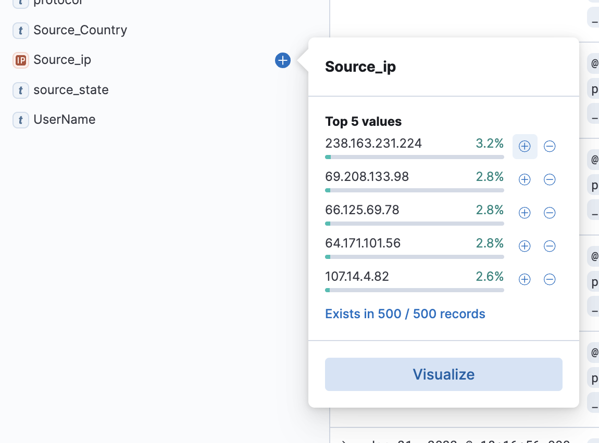

- + 버튼: 해당 값 포함 로그만 필터링
- - 버튼: 해당 값 제외 로그만 필터링

### 3) Timeline

> 시간대별 이벤트 수를 바(bar) 차트로 시각화

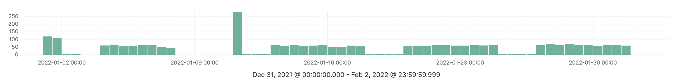

### 4) Create Table

> 로그 상세 정보 클릭 후 중요 필드(Selected fields)만 선택 - 테이블 형식으로 가시성 향상 가능

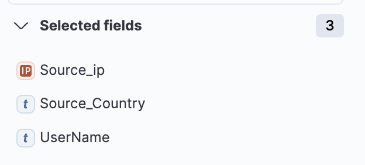

selected fields에 해당 항목을 추가하면 필드에 해당 항목만 보이게 됨

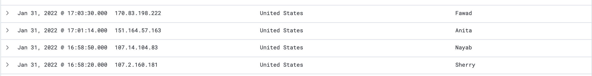

### 5) 문제

#### Q. Select the index **vpn_connections** and filter from 31st December 2021 to 2nd Feb 2022. How many hits are returned?

##### 답: 2861

문제 주어진 날짜 조건에 맞게 필터링 한 뒤 update를 누르면 아래와 같은 결과가 나온다. 

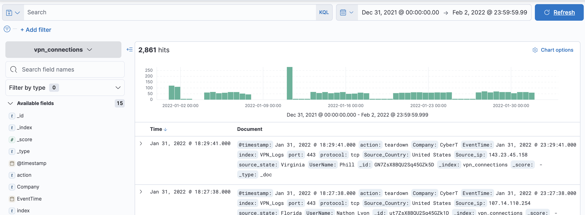

#### Q. Which IP address has the maximum number of connections?

##### 답: 238.163.231.224

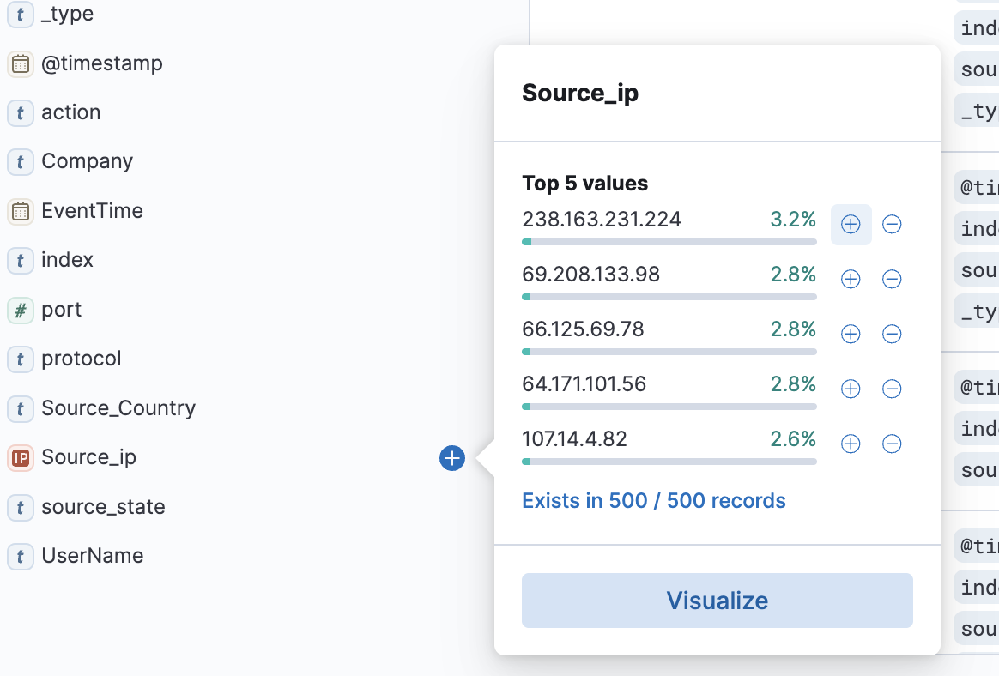

#### Q. Which user is responsible for the overall maximum traffic? 

##### 답: James

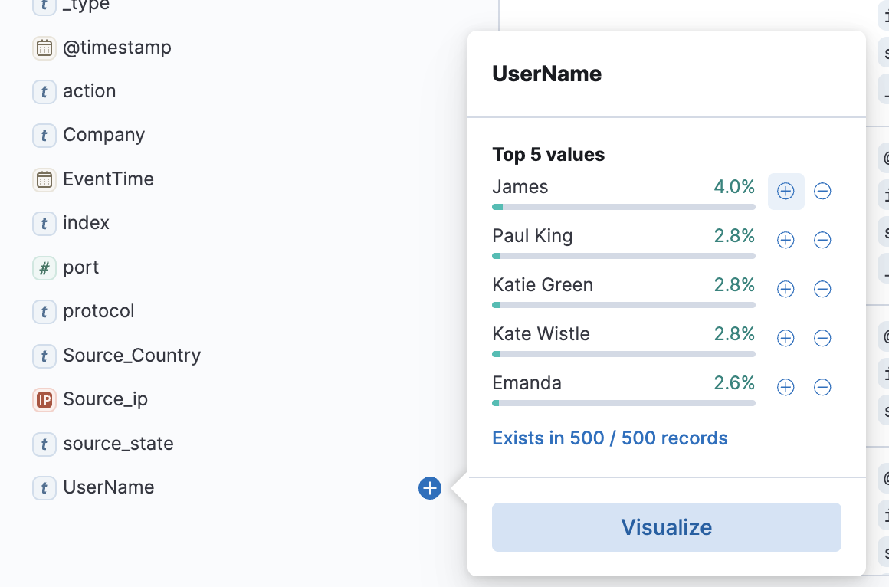

#### Q. Apply Filter on UserName Emanda; which SourceIP has max hits?

##### 답: 107.14.1.247

AddFilter를 누른 뒤 Username = Emanda 필터링을 추가한 뒤 Discover 탭을 살펴보자.

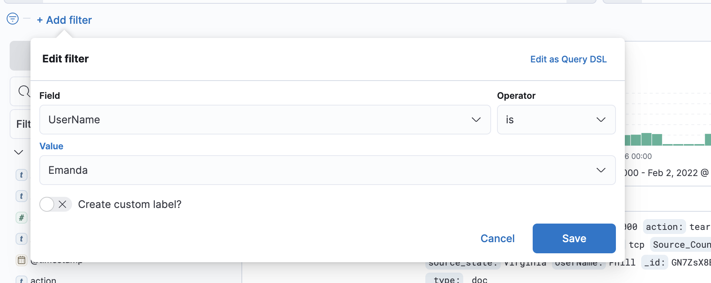

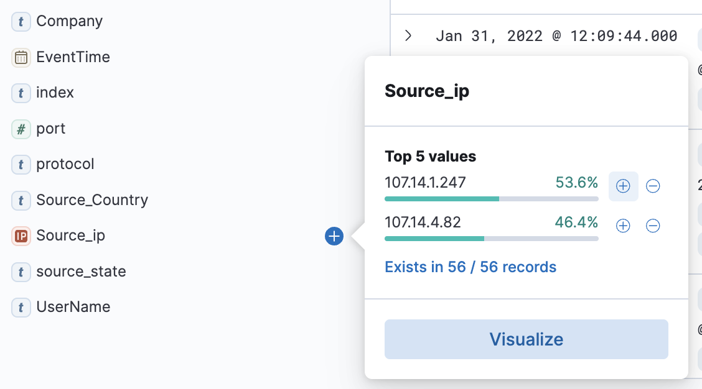

#### Q. On 11th Jan, which IP caused the spike observed in the time chart?

##### 답: 107.14.1.247

차트에서 날짜 부분을 클릭하면 해당 부분에 트래픽을 살펴볼 수 있다. 

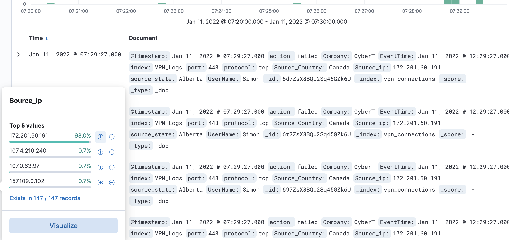

#### Q. How many connections were observed from IP **238.163.231.224**, excluding the **New York** state?

##### 답: 48

나 같은 경우 238.163.231.224를 필터링한 후 State_Country 항목을 살펴보았다. 

총 96개 중 50프로이므로 48개이다. 

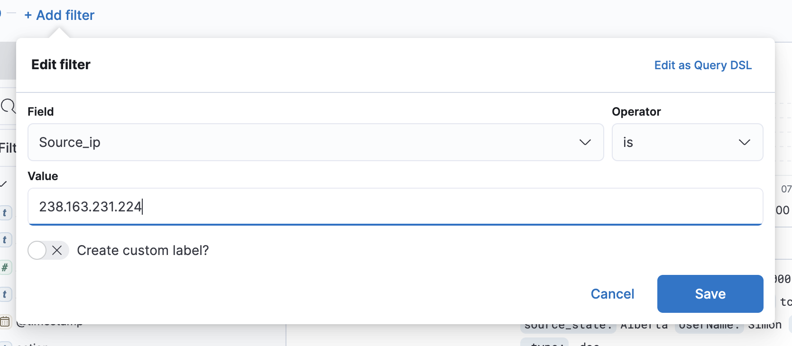

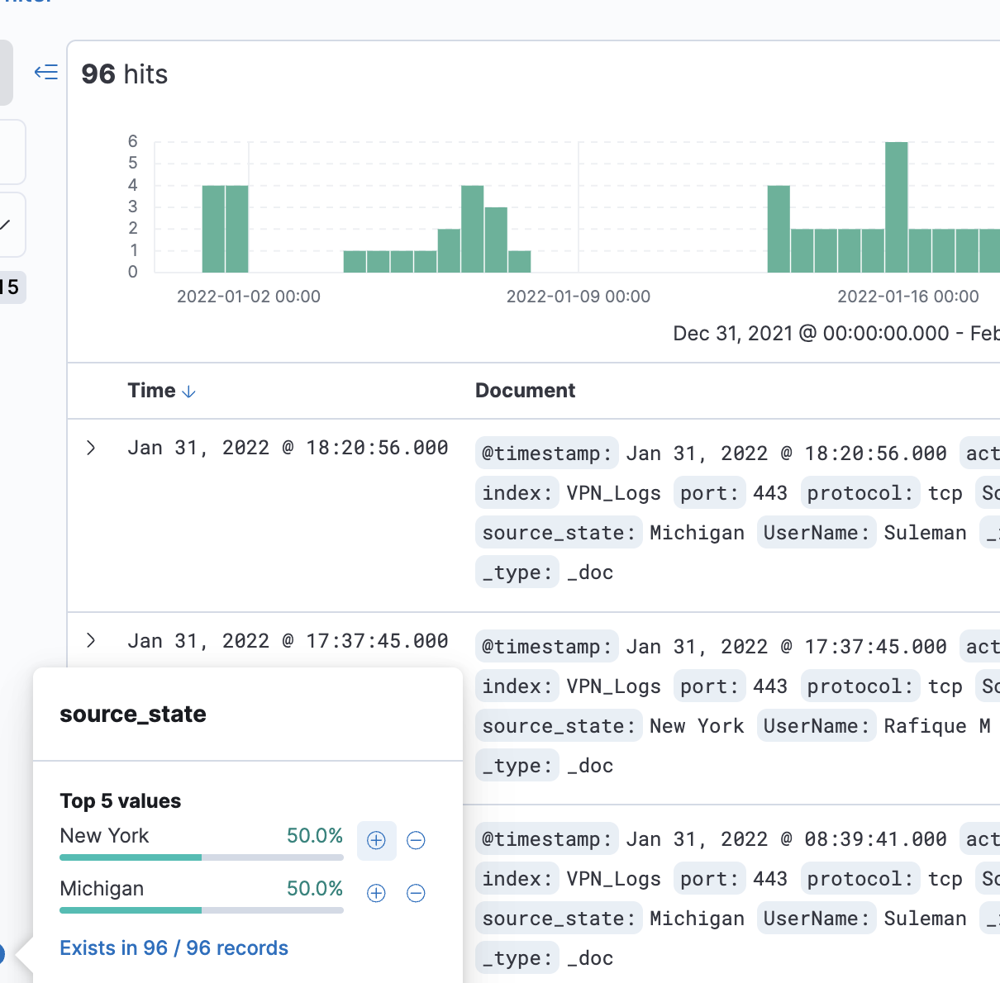

## 4. KQL

> Kibana의 Search Bar에서 사용하는 **쿼리 언어**로, Elasticsearch에 저장된 로그를 검색할 때 사용합니다.

### 1) 검색 방식 
#### ㄱ. 텍스트 검색

필드 구분 없이 **텍스트 자체**로 검색. 해당 단어가 포함된 모든 로그 반환.

|쿼리|설명|
|---|---|
|`United States`|"United States"가 포함된 모든 로그|
|`United`|❌ 결과 없음 (KQL은 **완전한 단어** 단위로 검색)|
|`United*`|✅ "United"로 시작하는 모든 단어 검색 (와일드카드)|

> ⚠️ KQL은 **부분 단어를 인식하지 못함** → 와일드카드 `*` 활용 필요

---

#### ㄴ. 필드 기반 검색

**특정 필드**를 지정해서 검색. 훨씬 정확한 결과 반환.

**문법**: `필드명 : 값`

```
Source_ip : 238.163.231.224 AND UserName : Suleman
```

→ IP가 `238.163.231.224`이고 사용자명이 `Suleman`인 로그만 표시

> Search Bar 클릭 시 사용 가능한 **전체 필드 목록** 자동 표시

---

#### ㄷ. 논리 연산자 (Logical Operators)

|연산자|예시|설명|
|---|---|---|
|`AND`|`"United States" AND "Virginia"`|두 조건 **모두** 포함|
|`OR`|`"United States" OR "England"`|둘 중 **하나** 포함|
|`NOT`|`"United States" AND NOT ("Florida")`|특정 조건 **제외**|

### 2) 문제

#### Q. Create a search query to filter the logs where **Source_Country** is the **United States** and show logs from User **James** or **Albert**. How many records were returned?

##### 답: 161

검색창에  `Source_Country : United* AND (UserName : James OR UserName : Albert)` 쿼리 입력

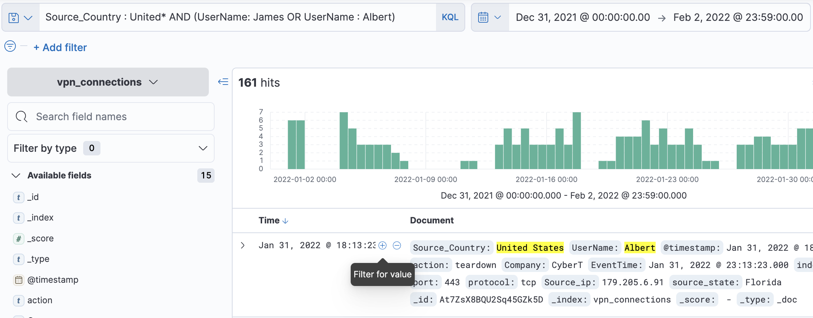

#### Q. A user **Johny Brown** was terminated on the 1st of January, 2022. Create a search query to determine how many times a VPN connection was observed after his termination.

##### 답: 1

TimeFilter를 이용하여 2022년 1월 1일 23:59:59:999 이후로 필터링, Username: "Johny Brown" 검색 시 하나의 vpn 로그만 뜸

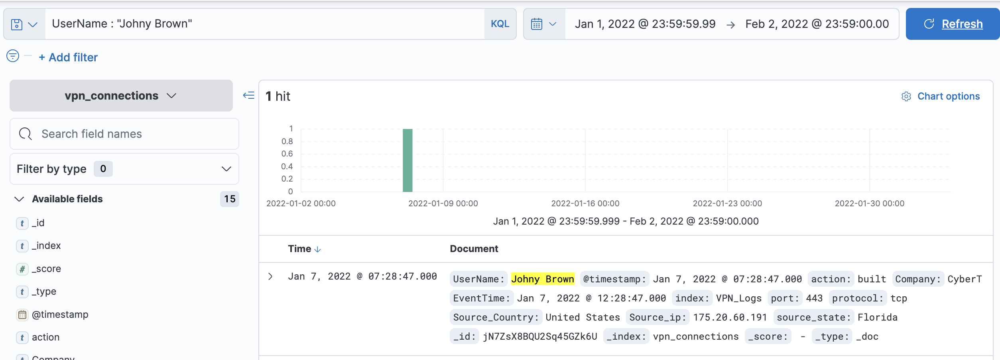

## 5. Kibana Visualize 탭

### 1) 개요

> 원하는 항목을 클릭, Visualize 버튼을 통해 시각화가 가능합니다.

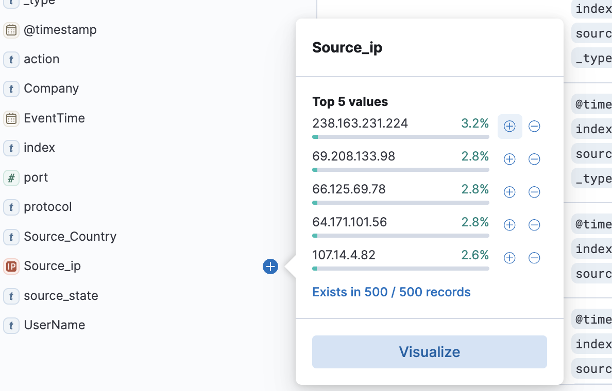

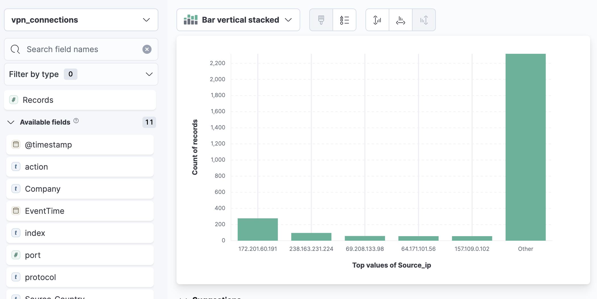


>  Correlation (상관관계) 옵션

두 개 이상의 필드 사이의 관계를 보고 싶을 때 사용합니다.

- 필드를 **가운데로 드래그**하면 Correlation 탭이 생성됩니다.
- 예시: `Source_Country`를 두 번째 필드로 선택해 클라이언트 `Source_IP`와의 상관관계를 확인합니다.

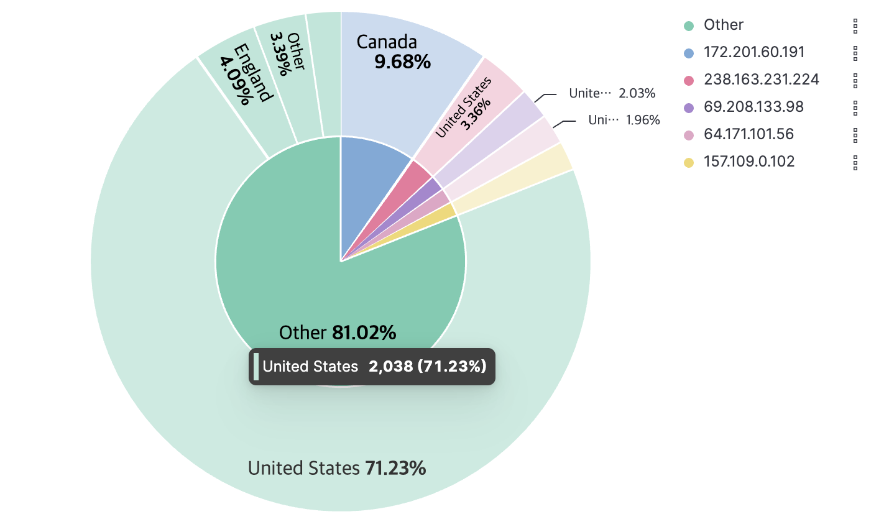

또한 선택한 필드 값을 **열(column)로 보여주는 테이블**도 만들 수 있습니다.

---

### 2) 실습: 실패한 VPN 연결 시도 테이블 만들기

> 1. Discover Tab -> Visualize Libaray로 이동 -> Create -> Len 선택


> 2. Add Filter 를 이용해 실패한 연결(action = fail)을 필터링한다.

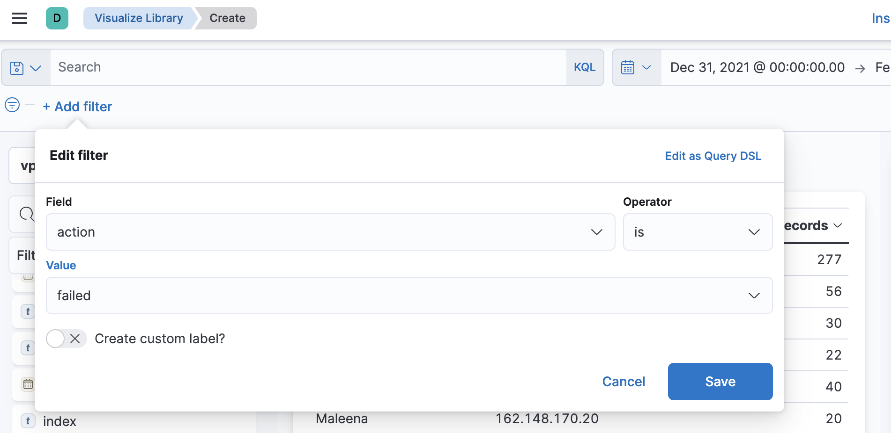

> 3. 탐색하고자 하는 항목 UserName과 Source_ip를 드래그해 원하는 데이터 테이블을 만든다.

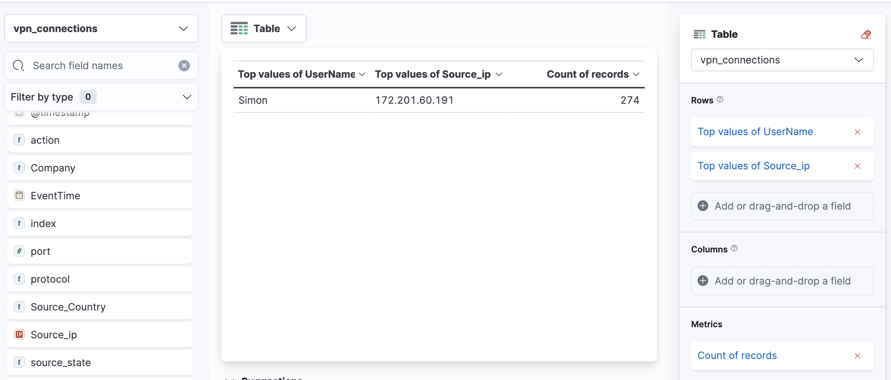

> 4. 오른쪽 탭을 활용, 테이블의 속성명을 변경하고 저장할 수 있다. 


### 3) 문제

#### Q. Which user was observed with the greatest number of failed attempts?

##### 답: Simon

실습에서 알 수 있듯이 Filter작업을 통해 Simon이 실패한 시도를 할 수 있다는 것을 알 수 있다.

#### Q. How many wrong VPN connection attempts were observed in January?

##### 답: 274

위 실습 과정에서 Time Filter에 1월을 한정하여 다시 한 번 탐색했을 때도 똑같이 274가 나왔다. 