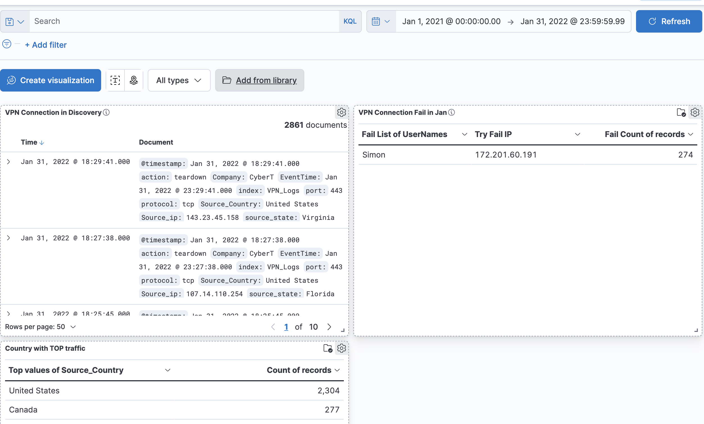

## 1. Kibana 커스텀 대시보드

> 여러 개의 저장된 검색(Searches)과 시각화(Visualizations)를 한 화면에 모아 보는 기능입니다. 로그 수집 상황을 한눈에 파악할 수 있어 VPN 로그 모니터링에 적합합니다.

### 1) 사전 준비

이 과정은 앞에서 만들어 둔 항목을 재사용합니다.

- **Discover 탭**에서 저장한 **Searches**
- **Visualize 탭**에서 저장한 **Visualizations**

### 2) 대시보드 생성 순서

1. Dashboard 탭으로 이동 후 Create dashboard 클릭
2. Add from Library 클릭
3. 추가할 시각화와 저장된 검색을 선택 → 대시보드에 자동 추가
4. 각 항목의 크기와 위치를 조정해 보기 좋게 배치
5. 작업이 끝나면 반드시 Save (저장)

