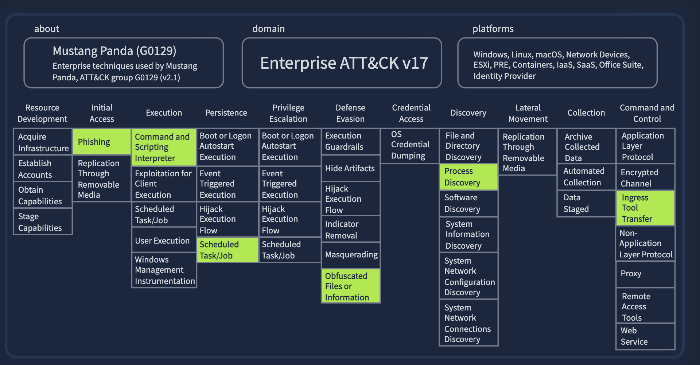
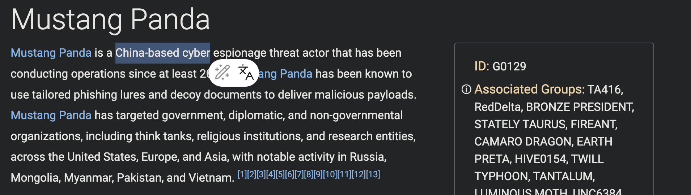
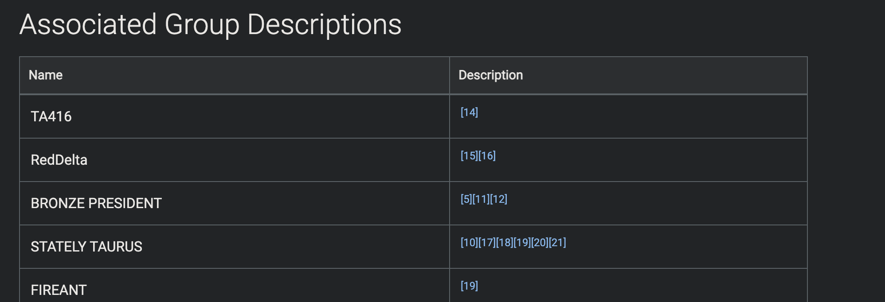
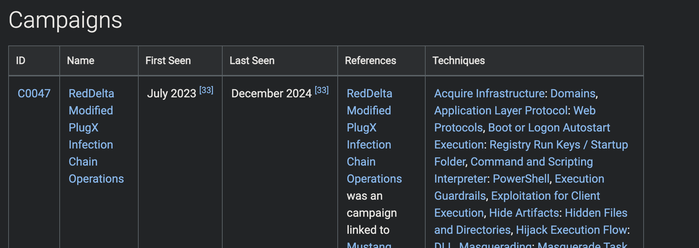
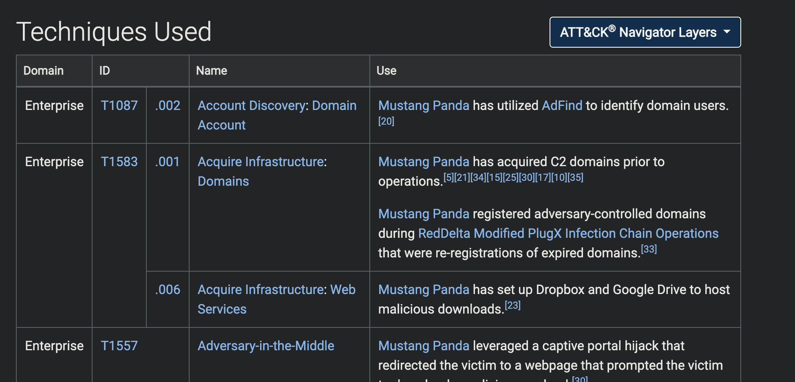
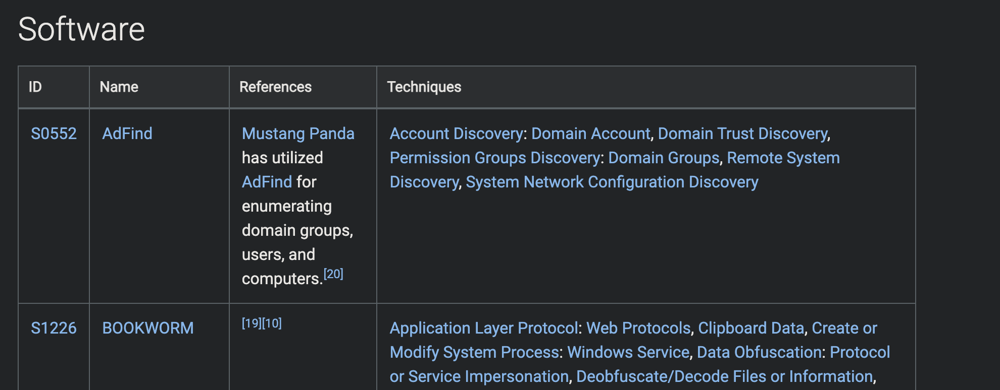
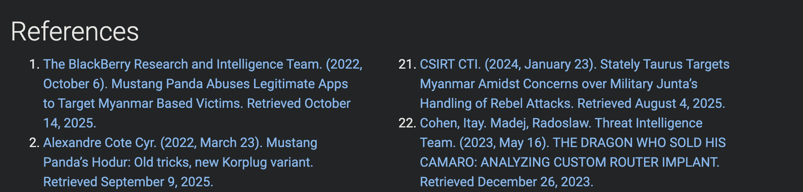
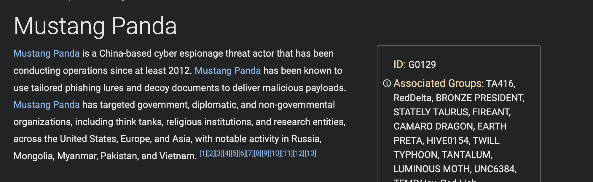
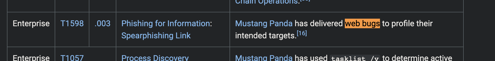
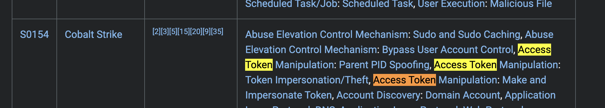

## 1. 필요성

| 이유                  | 내용                                                                                               |
| ------------------- | ------------------------------------------------------------------------------------------------ |
| **표준 언어 제공**        | 같은 행위를 여러 이름으로 부르는 혼란을 줄이고, **표준 용어와 고유 ID**로 데이터·사건 비교와 보안 커뮤니티 간 소통을 쉽게 함                      |
| **위협 인텔리전스와 방어 연결** | 위협 보고서는 공격자가 **무엇을 했는지**는 알려주지만 탐지 방법까지는 알려주지 않음. 위협 활동을 TTP에 매핑하면 **탐지 로직, 쿼리, 플레이북**으로 바꿀 수 있음 |

---

## 2. 활용방법

|대상|목표|ATT&CK 활용 방식|
|---|---|---|
|**CTI 팀**|위협 정보를 수집·분석해 보안 태세 개선|관찰한 위협 행위자 행동을 TTP에 매핑해 업계 전반에서 쓸 수 있는 **프로파일** 작성|
|**SOC 분석가**|보안 경보 조사·분류|활동을 전술·기법에 연결해 경보에 **상세한 맥락**을 주고 사건 **우선순위** 결정|
|**탐지 엔지니어**|탐지 시스템 설계·개선|SIEM/EDR 등의 룰을 ATT&CK에 매핑해 **탐지 커버리지** 개선|
|**인시던트 대응팀**|보안 사고 대응·조사|사고 타임라인을 전술·기법에 매핑해 공격을 **시각화**|
|**레드·퍼플팀**|공격자 행동을 모방해 방어 테스트·개선|기법과 알려진 그룹의 작전에 맞춘 **에뮬레이션 계획과 훈련** 구성|

---

## 3. Mapping Action (실습)

> 실습 예시: Mustang Panda (G0129)

| 구분    | 내용                                                                                                          |
| ----- | ----------------------------------------------------------------------------------------------------------- |
| 상단 박스 | 그룹 정보: Mustang Panda, G0129 도메인: Enterprise ATT&CK v17 적용 플랫폼: Windows, Linux, macOS, 네트워크 장비, 클라우드 등 |
| 가로 열  | 전술(Tactic). 공격자의 목표입니다.                                                                                     |
| 세로 열  | 각 전술 아래의 기법(Technique)입니다.                                                                                  |
| 초록색 칸 | 이 그룹이 **실제로 사용한 것으로 확인된 기법**입니다. 회색 칸은 이 그룹과 매핑되지 않은 기법                                                     |

## 4. 문제

### MITRE ATT&CK 사이트 알아보기

> 1. 타이틀 - 소개

> 2. Associated Group Descriptions : 각 회사에서 부르는 공격의 별칭들을 나열

> 3. Campain: 실제로 관찰된 공격 사례

> 4. Techniques Used: 그 그룹이 사용한 ATT&CK 기법을 전부 모아 놓은 표

> 5. Software: 실제로 사용한 악성코드와 도구 목록

> 6. Reference: 참고자료

#### Q. In which country is Mustang Panda based?

> 머스탱 팬더는 어느 나라에 본사를 두고 있나요?

##### A. China

#### Q. Mustang Panda has delivered web bugs to profile its targets. Which ATT&CK technique ID covers this?

> Mustang Panda는 표적의 행동을 분석하기 위해 웹 버그를 심었습니다. 이를 다루는 ATT&CK 기법 ID는 무엇입니까?

##### A. T1598

-  Techniques Used 항목에 위치

#### Q. Which software is Mustang Panda known to use for Access Token Manipulation?

##### A. Cobalt Strike

- Software 항목에 위치