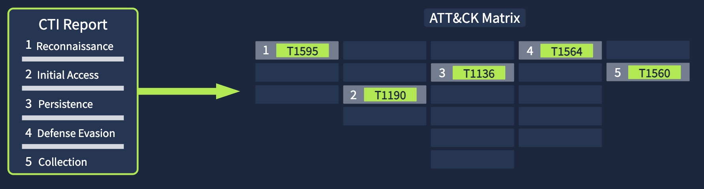
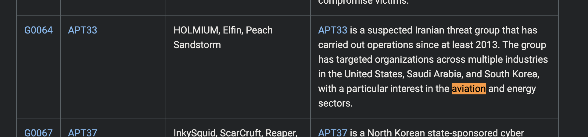
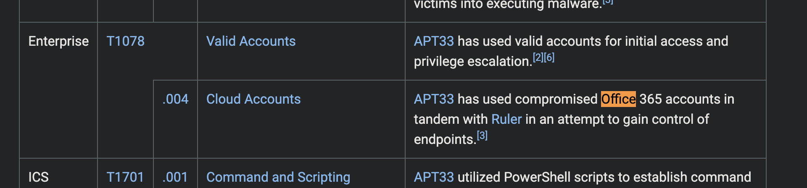

## 1. 개요(실습)

> 앞서 배운 **ATT&CK로 위협 인텔리전스를 활용하는 방법**을 직접 적용해 보는 실습입니다. 특정 조직을 노리는 위협 그룹을 조사하고, 방어에 빈틈이 있는지 평가합니다.

---

## 2. 시나리오

|항목|내용|
|---|---|
|**내 역할**|**항공 분야** 조직의 보안 분석가|
|**조직 상황**|인프라를 **클라우드로 이전(마이그레이션) 중**|
|**임무**|ATT&CK로 이 분야를 노리는 **APT 그룹** 정보를 수집하고, 전술·기법을 파악해 **방어 커버리지의 공백** 평가|

---

## 3. 진행 방법

> 1. 그룹 선정

https://attack.mitre.org/groups/ 를 탐색, 항공 분랴를 노리는 적절한 그룹 찾기

> 2. 행동 분석

선정한 그룹의 페이지에 들어가 `Techniques Used` 와 `Software` 등을 살펴본다.

| 단계           | 할 일                                               | 사용 도구                       |
| ------------ | ------------------------------------------------- | --------------------------- |
| **1. 그룹 선정** | ATT&CK 웹사이트의 **Groups** 섹션에서 항공 분야를 노리는 적절한 그룹 찾기 | ATT&CK Groups 페이지           |
| **2. 행동 분석** | 선택한 그룹의 활동을 **Navigator 레이어**와 **기법 페이지**로 분석     | ATT&CK Navigator, 기법 상세 페이지 |
| **3. 갭 평가**  | 그 그룹이 쓰는 기법에 비해 우리 방어에 빠진 부분이 있는지 점검              | 매핑 결과                       |

---

## 4. 문제

#### Q. Which APT group has targeted the aviation sector and has been active since at least 2013?

> 2013년 이후로 꾸준히 활동해 왔으며 항공 산업을 표적으로 삼은 APT 그룹은 어디인가요?
##### A. APT33

#### Q. Which ATT&CK sub-technique used by this group is a key area of concern for companies using Office 365?

> 이 그룹이 사용하는 ATT&CK 하위 기법 중, Office 365를 사용하는 기업들에게 가장 큰 우려 사항이 되는 것은 무엇입니까?

##### A. Cloud Attack

#### Q. According to ATT&CK, what tool is linked to the APT group and the sub-technique you identified?

##### A.

#### Q. Which mitigation strategy advises removing inactive or unused accounts to reduce exposure to this sub-technique?

##### A.

#### Q. What Detection Strategy ID would you implement to detect abused or compromised cloud accounts?

##### A.