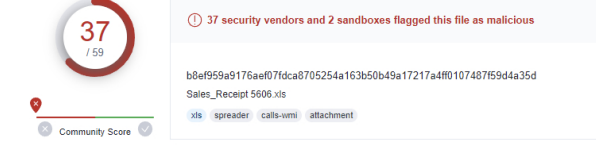

## 1. 해시값

> 데이터를 고정된 길이의 숫자 값으로 변환한 결과물. 데이터를 고유하게 식별하는 데 사용됩니다.

### 1) 주요 해싱 알고리즘

|알고리즘|설계 연도|출력 크기|보안 상태|
|---|---|---|---|
|**MD5**|1992 (Ron Rivest)|128비트|❌ 안전하지 않음 (해시 충돌 취약)|
|**SHA-1**|1995 (NSA)|160비트 (40자리 hex)|❌ NIST가 2011년 사용 중단, 2013년 금지|
|**SHA-256**|2001 (NIST + NSA)|256비트 (64자리 hex)|✅ 현재 권장|

### 2) 보안에서의 활용

- 악성코드 샘플이나 의심 파일을 고유하게 식별하는 데 사용
- 랜섬웨어 분석 보고서 등에서 IoC(침해 지표) 로 활용
- 조회 도구: VirusTotal, MetaDefender Cloud (OPSWAT)

### 3) 해시값은 불완전한 IoC 지표이다.

> 상황 가정

보안팀이 악성코드를 발견하고 해시값을 등록해뒀어요.

```
악성코드.exe → MD5: AAAA1111
```

이제 이 해시를 탐지 시스템에 올려두면 **"이 해시 나오면 차단!"** 하겠죠.

> if: 공격자가 악성코드 파일 맨 끝에 아무 의미 없는 글자 하나만 추가한다면

```
악성코드_v2.exe → MD5: BBBB2222  ← 완전히 다른 해시!
```

기능은 **똑같은 악성코드**인데, 해시가 달라졌으니 탐지 시스템은 **"모르는 파일이네, 통과!"** 해버려요.

> 결론

즉, "파일 내용이 같아도 해시가 다르면 탐지 못 한다"는 게 한계가 있다.

### 3) 문제

#### Q. Analyse the report associated with the hash "b8ef959a9176aef07fdca8705254a163b50b49a17217a4ff0107487f59d4a35d" [here.](https://assets.tryhackme.com/additional/pyramidofpain/t3-virustotal.pdf) What is the filename of the sample?

##### 답: Sales_Receipt 5606.xls


