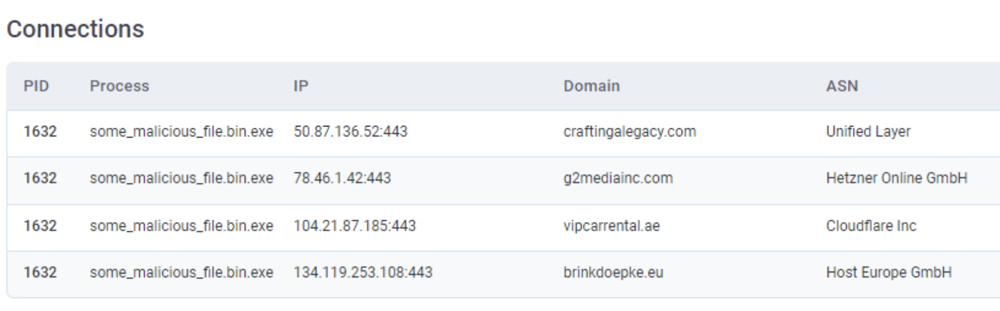

> Pyramid of Pain 단계에서 - GREEN(easy)

- IP 주소는 IoC로 활용할 수 있지만, 공격자가 쉽게 바꿀 수 있기 때문에 **Pyramid of Pain에서 하위(쉬운) 단계**에 위치합니다. 즉, 공격자 입장에서 IP 변경은 큰 고통이 아닙니다

## 1. ip address

> 네트워크에 연결된 모든 장치(데스크탑, 서버, CCTV 등)를 식별하는 주소. 보안에서는 공격자가 사용하는 IP를 추적하는 데 활용됩니다.

## 2. 방어 관점

공격자의 IP를 파악하면 **방화벽에서 해당 IP의 인바운드 요청을 차단**할 수 있습니다.

> but, 숙련된 공격자는 새로운 공인 IP를 사용하는 것만으로 간단히 우회할 수 있습니다.

## 3. Fast Flux

> IP 차단을 어렵게 만드는 기술

- 봇넷이 사용하는 DNS 기법으로, 하나의 도메인에 여러 IP 주소를 연결하고 이를 지속적으로 교체하는 방식입니다.

## 4. 문제

> 리포트(anyrun.pdf)는 무엇인가?

- 샌드박스 서비스에서 `some_malicious_file.bin`을 격리된 가상 Windows 7 환경에 넣고 실제로 실행한 뒤, 그동안 일어난 일을 자동으로 기록해 정리한 결과물입니다.

- 이 보고서를 통해 IoC 추출, 악성코드 분류 등, 위협 대응 등의 행위를 할 수 있습니다.

> anyrun.pdf에는 어떤 내용이 있을까?

전체 내용에 대해 정리하기보다 핵심 내용에 대해서 간단히 정리하려고 한다.

| 항목            | 설명                                                                                                                                                                                                            |
| --------------- | --------------------------------------------------------------------------------------------------------------------------------------------------------------------------------------------------------------- |
| 파일 정보       | Sodinokibi(REvil) 랜섬웨어, PE32 실행 파일 (GUI) 형식으로 되어 있다.                                                                                                                                            |
| 실행흐름        | 아래 내용 참고                                                                                                                                                                                                  |
| 레지스트리 활동 | `HKLM\SOFTWARE\recfg` 아래에 `pub_key`, `pk_key`, `sk_key`, `0_key`, `rnd_ext`, `stat` 값을 기록                                                                                                                |
| 파일 활동       | (의심 파일 263개) 여러 폴더에 `xxxxx-readme.txt`(랜섬노트)를 뿌립니다. 모든 노트의 MD5가 같아서 동일한 내용의 파일을 복사한 것임을 알 수 있다.                                                                  |
| 네트워크 활동   | IP 하나를 막아도 다른 도메인과 IP로 통신하면 그만이고, 도메인 하나에 IP가 여러 개 붙어 있으면 그중 하나를 막아도 소용없습니다. 방금 배운 대로 **IP 기반 IoC는 공격자가 쉽게 바꿀 수 있어서** 한계가 있다는 사례 |

#### a. 실행 흐름

Explorer.EXE
└─ some_malicious_file.bin.exe (PID 2256, 중간 권한)
└─ some_malicious_file.bin.exe (PID 1632, 높은 권한) ← 자기 자신을 다시 실행해 권한 상승
└─ cmd.exe (PID 448)
├─ vssadmin.exe Delete Shadows /All /Quiet ← 섀도 복사본 삭제
├─ bcdedit /set {default} recoveryenabled No ← 복구 기능 비활성화
└─ bcdedit /set {default} bootstatuspolicy ignoreallfailures

> 복구 수단을 먼저 없애는 것이 랜섬웨어의 전형적인 수법입니다.

#### b. 네트워크 흐름

> 문제 풀이할 때 사용되는 정보이므로 좀 더 자세히 풀이하도록 하겠음

실행 권한을 뺏는 실행 파일(some_malicious_file.bin.exe)이 4개의 다른 IP에 존재합니다. 만약 방화벽을 통해 특정 IP를 막는다 해도 다른 IP에서 다운받을 수 있으므로 보안적인 한계가 있다.

#### Q. Read the following [report](https://assets.tryhackme.com/additional/pyramidofpain/task3-anyrun.pdf) to answer this question. What is the **first IP address** the malicious process (**PID 1632**) attempts to communicate with?

##### 답: 50.87.136.52

#### Q. Read the following [report](https://assets.tryhackme.com/additional/pyramidofpain/task3-anyrun.pdf) to answer this question. What is the **first domain name** the malicious process ((PID 1632) attempts to communicate with?

##### 답: craftingalegacy.com
