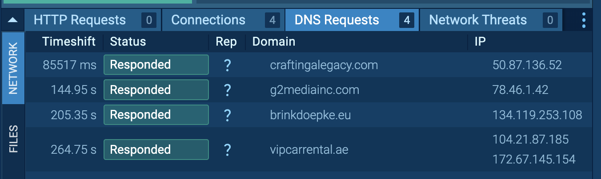

## 1. Domain

> IP 주소를 **문자열 텍스트로 매핑**한 것

- `evilcorp.com` → 도메인 + 최상위 도메인(TLD)
- `tryhackme.evilcorp.com` → 서브도메인 + 도메인 + TLD

---
## 2. 공격 vs 방어

| 구분  | 내용                                              |
| --- | ----------------------------------------------- |
| 공격자 | 도메인 **구매 → 등록 → DNS 레코드 수정** 필요 → IP보다 변경이 번거로움 |
| 방어자 | 단, 많은 DNS 제공업체가 느슨한 기준 + API 제공 → 공격자가 쉽게 우회 가능 |

---
## 3. 공격 기법 1: Punycode 공격

> Punycode: ASCII로 쓸 수 없는 문자를 Unicode ASCII로 변환하는 방식

- 예시: `adıdas.de` → 실제 Punycode: `http://xn--addas-o4a.de/`
- 사용자가 보기에 **합법적인 도메인처럼** 보이지만 실제론 악성 도메인으로 리다이렉트
- 최신 브라우저(Chrome, Edge, Safari 등)는 대부분 탐지 가능

---

## 4. 공격 기법 2: URL 단축 서비스 악용

> 악성 도메인을 짧은 URL로 숨겨 사용자를 속임

- 예) `bit.ly/example+` - 단축 URL 뒤에 `+` 를 붙이면 실제 리다이렉트 주소 확인 가능  

---

## 5.  탐지 방법

- Proxy 로그 / 웹 서버 로그 분석
- Any.run 샌드박스 → Networking 탭 활용

| 탭             | 내용                                    |
| ------------- | ------------------------------------- |
| HTTP Requests | 웹 서버에서 가져오는 리소스 확인 (드로퍼, 콜백 등)        |
| Connections   | 프로세스가 외부 호스트와 통신하는 내용 (C2 트래픽, FTP 등) |
| DNS Requests  | 악성코드가 보내는 DNS 요청 (인터넷 연결 확인, 콜 홈 등)   |

> ⚠️ Any.run 보고서의 IP/URL은 악성코드 행동 결과이므로 직접 접속 절대 금지

## 6. 문제

#### Q. Go to [this report on app.any.run](https://app.any.run/tasks/a66178de-7596-4a05-945d-704dbf6b3b90) and provide the first **suspicious** domain request you are seeing, you will be using this report to answer the remaining questions of this task.

##### 답: craftingalegacy.com

- 앞서 anyruns에 탐지된 사이트들은 모두 악성 url/dns. 따라서 제일 첫번재 Domain인 craftingalegacy.com이 답이 된다. 

#### Q. What term refers to an address used to access websites?

##### 답: Domain Name

#### Q. What type of attack uses Unicode characters in the domain name to imitate the a known domain?

##### 답: Punycode attack

##### Q. Provide the redirected website for the shortened URL using a preview: https://tinyurl.com/bw7t8p4u

##### 답: `https://tryhackme.com/`

- 문제에서 가리킨 사이트를 접속해보면 https://tryhackme.com/ 가 나온다. 

