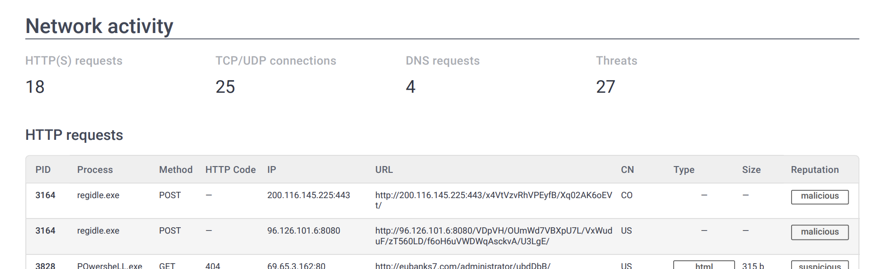
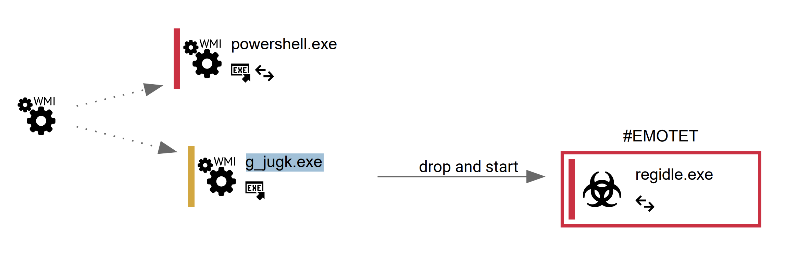
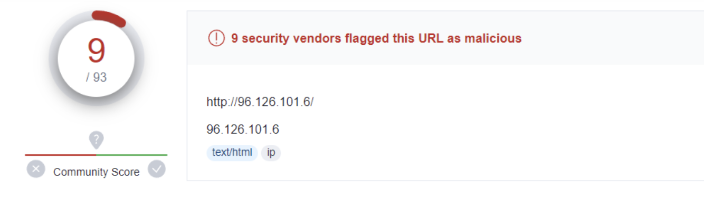

## 1. Host Artifacts란?

> 공격자가 시스템에 남기는 **흔적 또는 관찰 가능한 증거들**

---
## 2. 🟡 Yellow Zone의 의미

- 이 단계에서 탐지당하면 공격자는 **짜증 + 좌절감**을 느낌
- 공격자는 처음으로 돌아가 **공격 도구와 방법론을 바꿔야** 함
- **시간 소모 + 추가 리소스** 필요 → 공격자에게 실질적인 고통

---

## 3. Host Artifacts의 종류

|유형|예시|
|---|---|
|**레지스트리 값**|악성코드가 남긴 레지스트리 항목|
|**의심스러운 프로세스 실행**|Word에서 비정상적인 자식 프로세스 실행|
|**공격 패턴 / IOC**|침해 지표 (Indicators of Compromise)|
|**악성 애플리케이션이 드롭한 파일**|악성코드 실행 후 생성된 파일|
|**이벤트 로그**|악성 앱 실행 후 연이어 발생하는 의심 이벤트|

---

## 4. 대표 사례

> 1. Word에서의 의심스러운 프로세스 실행

- 정상적인 Word는 `cmd.exe`, `powershell.exe` 같은 프로세스를 실행하지 않음
- 이런 패턴이 보이면 악성 매크로 등의 공격 의심

> 2. 악성 앱 실행 후 연속 의심 이벤트

- 악성 애플리케이션 오픈 → 연쇄적으로 비정상 이벤트 발생
- 이벤트 로그로 추적 가능

> 3. 악성 행위자가 수정/드롭한 파일

- 공격자가 시스템에 심어놓거나 변조한 파일들
- 파일 경로, 이름, 해시 등이 IOC가 됨

## 5. 문제

#### Q. A security vendor has analysed the malicious sample for us.  Review the report [here](https://assets.tryhackme.com/additional/pyramidofpain/task5-report.pdf) to answer the following questions.

##### 답: No Answer

#### Q. A process named regidle.exe makes a POST request to an IP address based in the United States (US) on port 8080. What is the IP address?

> regidle.exe라는 프로세스가 미국(US)에 위치한 IP 주소의 8080번 포트로 POST 요청을 보냅니다. 해당 IP 주소는 무엇입니까?

##### 답: 96.126.101.6

#### Q. The actor drops a malicious executable (EXE). What is the name of this executable?

> 공격자는 악성 실행 파일(EXE)을 유포합니다. 이 실행 파일의 이름은 무엇입니까?

##### 답: g_jugk.exe

#### Q. Look at this [report](https://assets.tryhackme.com/additional/pyramidofpain/vtotal2.png) by VirusTotal. How many vendors determine this host to be malicious?

> VirusTotal의 이 보고서를 보세요. 이 호스트를 악성이라고 판단한 업체가 몇 곳이나 되나요?

##### 답: 9

