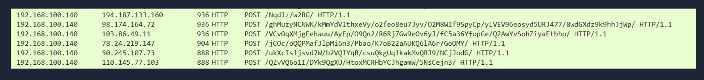

## 1. Network Artifacts란?

> 네트워크 상에서 공격자가 남기는 **관찰 가능한 흔적들**

---

## 2. 🟡 Yellow Zone에서의 의미

- 탐지 시 공격자는 **전술 변경 또는 도구 수정** 필요
- 그만큼 **방어자에게 대응 시간**이 더 주어짐
- 기존 위협 제거 + 새로운 위협 탐지 여유 확보

---

## 3. 주요 Network Artifact 유형

|유형|설명|
|---|---|
|**User-Agent 문자열**|HTTP 요청 헤더에 포함, 환경에서 처음 보이거나 이상한 값이면 의심|
|**C2 정보**|악성코드가 공격자 서버와 통신하는 주소/패턴|
|**URI 패턴**|HTTP POST 요청에서 반복되는 비정상적인 경로 패턴|

---

## 4.  탐지 도구

| 도구                     | 용도                      |
| ---------------------- | ----------------------- |
| **Wireshark / TShark** | PCAP 파일(네트워크 패킷 덤프)을 분석 |
| **Snort (IDS)**        | 침입 탐지 시스템 알람으로 탐지       |

---

## 5. TShark 실전 명령어

bash

```bash
tshark --Y http.request -T fields -e http.host -e http.user_agent -r analysis_file.pcap
```

- HTTP 요청만 필터링
- 호스트명 + User-Agent 추출
- PCAP 파일에서 악성 User-Agent 패턴 탐색

---

## 6. 실제 사례 — Emotet 트로이목마

- Emotet은 **커스텀 User-Agent 문자열**을 사용하는 것으로 유명
- 이 문자열을 탐지하면 → **차단 규칙 적용 가능**
- 공격자 입장에서 추가 장애물이 생겨 더 번거로워짐

---

## 7. 문제

#### Q. Which network indicator helped us identify the malware type (Emotet)?

##### 답: User-agent

#### Q. How many POST requests are in the screenshot from the PCAP file?

##### 답: 6



