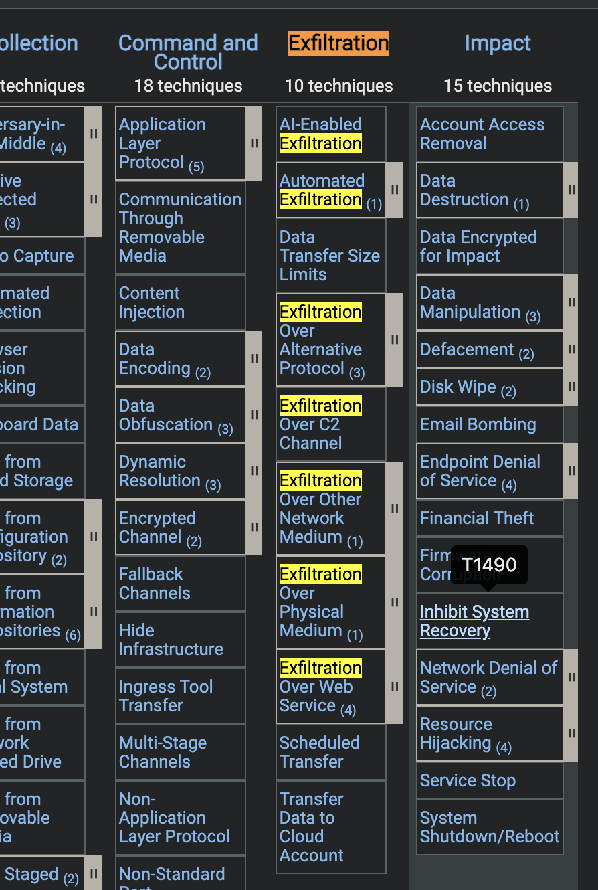

## 1. TTPs란?

> TTPs를 탐지 시 공격자에게 사실상 반격 기회를 주지 않음, 가장 탐지하기 어렵지만, 탐지 성공 시 가장 큰 타격

| 약어             | 의미                           |
| -------------- | ---------------------------- |
| **T**actics    | 공격자의 **전술** (목표 달성을 위한 큰 그림) |
| **T**echniques | 전술을 실행하는 **기술/방법**           |
| **P**rocedures | 기술을 실행하는 **구체적 절차**          |

---
## 2. MITRE ATT&CK Matrix

> 공격자가 목표를 달성하기 위해 사용하는 전술과 기술을 체계적으로 정리한 표(Matrix)야.

```   (세로축)
(가로축) 정찰 → 초기 침투 → 실행 → 지속성 확보 → 권한 상승 → 횡적 이동 → 데이터 유출
		↓       ↓        ↓        ↓        ↓        ↓            ↓

				각 단계마다 수십 가지 구체적 기술들이 나열됨
```

- 가로축 (Tactics) → 공격의 단계별 목표
- 세로축 (Techniques) → 각 목표를 달성하는 구체적 방법

---

## 3. 실제 사례: Pass-the-Hash 공격

> Windows Event Log 모니터링**으로 탐지

- 탐지 즉시:
    - 침해된 호스트 **빠르게 식별**
    - 네트워크 내 **횡적 이동(Lateral Movement) 차단**

---

## 4. 문제

#### Q. Navigate to ATT&CK Matrix webpage. How many techniques fall under the Exfiltration category?

> ATT&CK 매트릭스 웹페이지로 이동하세요. ‘정보 유출(Exfiltration)’ 범주에 속하는 기법은 몇 개나 되나요?

##### 답: 9



해당 사이트에서는 10이라고 나오는데 답은 9이다. (아마 최신화된 듯하다)

#### Q. Chimera is a China-based hacking group that has been active since 2018. What is the name of the commercial, remote access tool they use for C2 beacons and data exfiltration?

> 키메라(Chimera)는 2018년부터 활동해 온 중국 기반 해킹 집단입니다. 이 집단이 C2 비콘 및 데이터 유출에 사용하는 상용 원격 접속 도구의 이름은 무엇입니까?

##### 답: Cobalt Strike

Chimera 그룹은 Cobalt Strike 비콘**을 메모리에 로드해서 원격 접속과 C2(Command & Control) 용도로 사용했어. 

실제로 Cobalt Strike C2 비콘을 **데이터 유출(Exfiltration)**에도 활용한 것이 확인됐고, Cobalt Strike를 주요 원격 접속 트로이목마(RAT)로 사용하면서 Google Update로 위장하기도 했어.