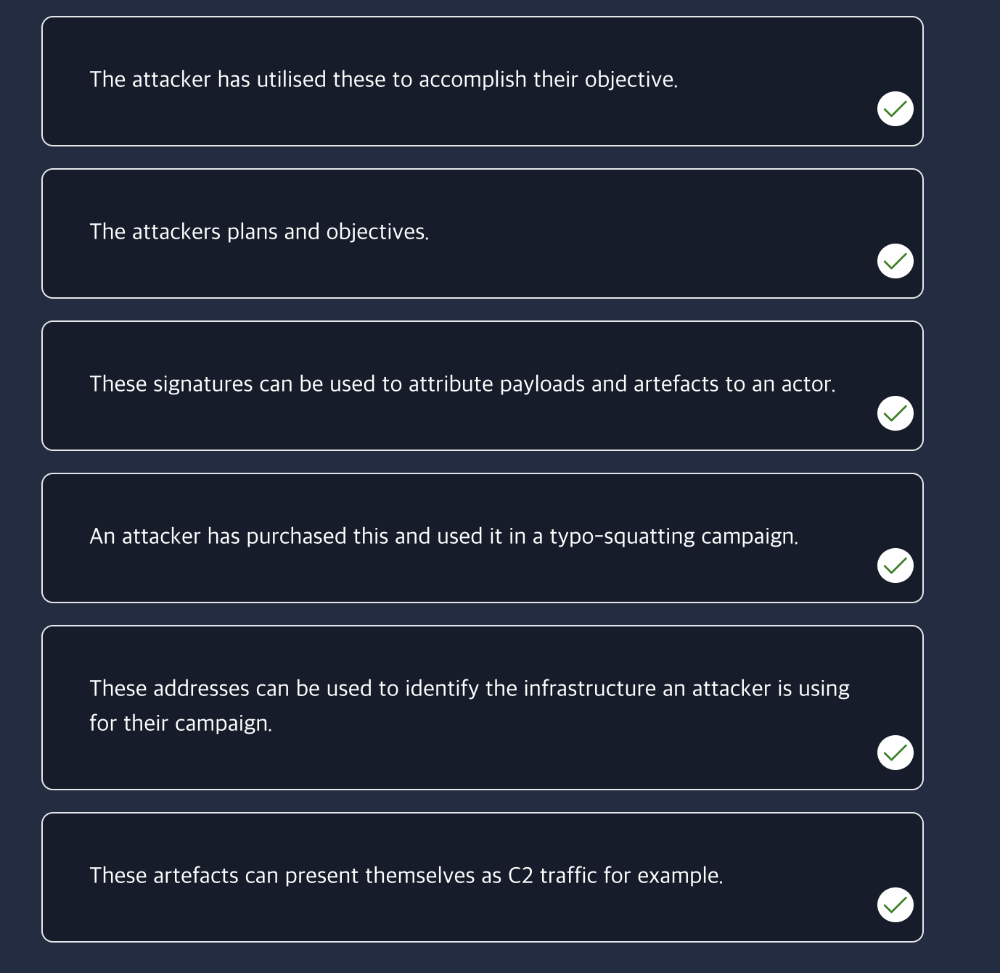

| 항목                                                                                                  | 단계               | 이유                                       |
| --------------------------------------------------------------------------------------------------- | ---------------- | ---------------------------------------- |
| The attacker has utilised these to accomplish their objective.                                      | **Tools**        | 공격자가 목표를 달성하려고 "사용하는 것"은 도구야.            |
| The attackers plans and objectives.                                                                 | **TTP**          | 계획과 목표는 전술(Tactics) 그 자체야.               |
| These signatures can be used to attribute payloads and artefacts to an actor.                       | **Hash values**  | 페이로드와 파일을 식별하고 특정 공격자에게 귀속시키는 시그니처는 해시야. |
| An attacker has purchased this and used it in a typo-squatting campaign.                            | **Domain Names** | 도메인을 구매해서 오타 도메인으로 속이는 공격이야.             |
| These addresses can be used to identify the infrastructure an attacker is using for their campaign. | **IP addresses** | 공격 인프라를 식별하는 주소는 IP야.                    |
| These artefacts can present themselves as C2 traffic for example.                                   | **Network**      | C2 트래픽, User-Agent, URI 패턴은 네트워크 아티팩트야.  |
