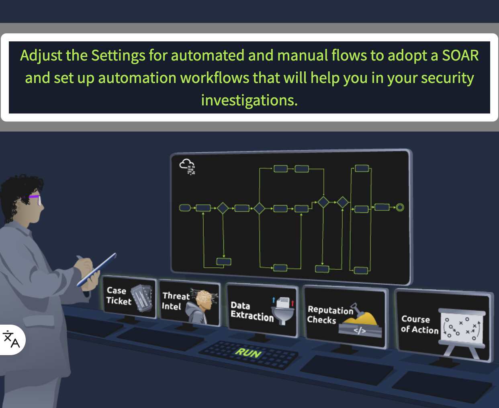
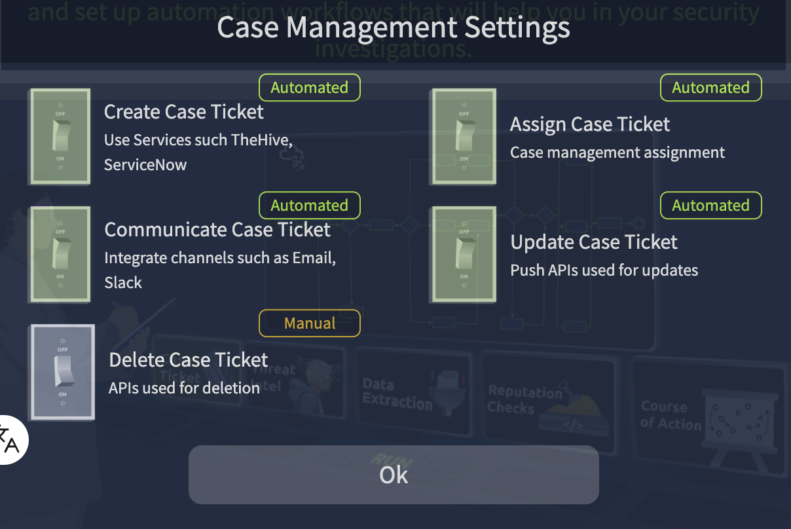
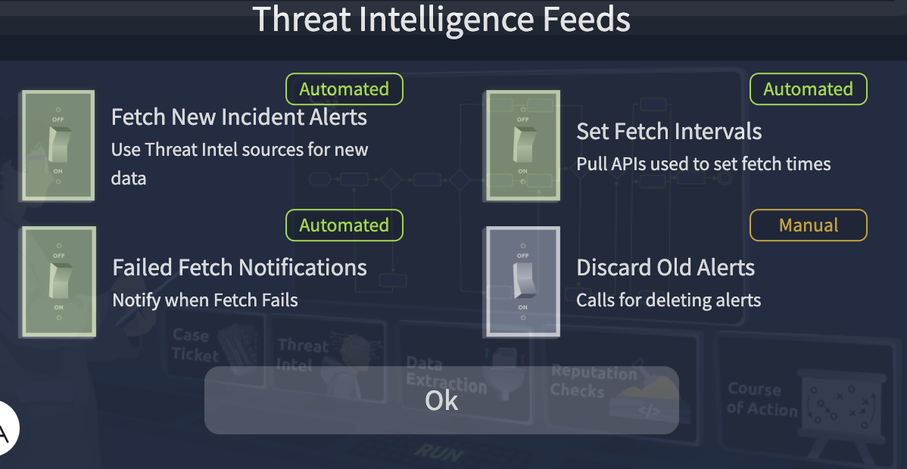
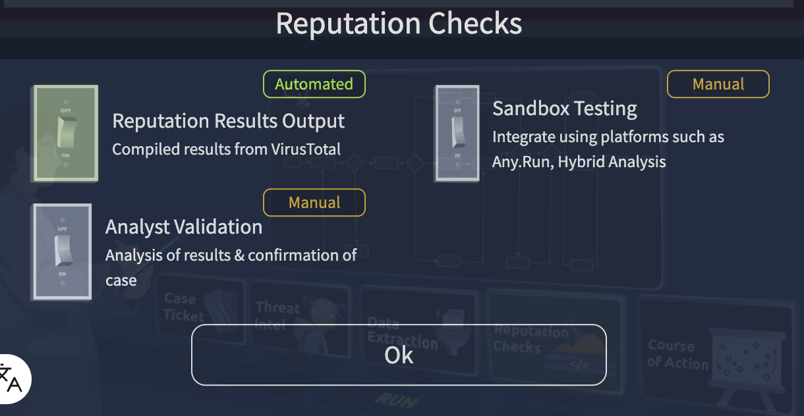
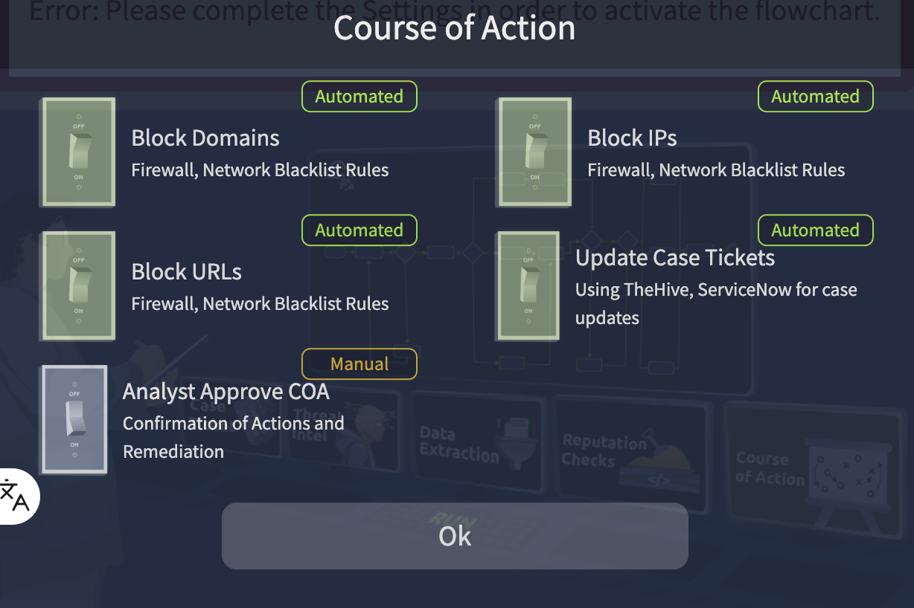

## 1. Playbook

> 특정 알림 유형에 대해 **"이 상황이면 이렇게 해라"** 는 조건 분기형 자동화 워크플로우입니다. 
> SOC 분석가가 직접 설계하며, SOAR가 이를 자동으로 실행합니다.

### 1) 피싱 (Phishing)

```
의심 이메일 수신 알림
        ↓
   티켓 생성
        ↓
  URL 또는 첨부파일 포함?
   ┌────┴────┐
  없음      있음
   ↓         ↓
사용자    URL인지 첨부파일인지?
알림      ┌────┴────┐
         URL      첨부파일
          ↓          ↓
      URL 평판    파일 샌드박스
        분석         분석
          ↓          ↓
        악성 여부 판단 → 대응 조치
```

---

### 2) CVE 패칭

> 새 CVE 발표 감지 시 SOAR에서 동작하는 자동화 워크플로우

```
새 CVE 발표 감지
      ↓
  CVE 상세 분석
      ↓
  우리 네트워크에 해당 취약점 존재?
  ┌────┴────┐
 없음      있음
  ↓         ↓
 종료    위험도(Risk) 평가
              ↓
          패칭 티켓 생성
              ↓
       테스트 환경에서 패치 적용
              ↓
        ✅ 분석가 검토·승인
              ↓
       프로덕션 환경에 배포
```


## 3) 문제 

#### Q. Is manual analysis vital within a SOAR workflow? **Yay** or **Nay**?

##### 답: Yay

#### Q. From where is the CVE Patching playbook fetching the new CVEs?

##### 답: advisory lists

CVE 패칭 플레이북의 흐름도에서 첫 단계가 advisory lists에서 새 CVE를 가져옵니다. 이후 단계로 SOAR가 새 CVE 정보를 받아들이고, 심각도와 악용 용이성에 따른 위험 임계값을 확인한 뒤, 영향받을 수 있는 시스템을 자산 목록에서 찾습니다.

#### Q. In the CVE Patching playbook, if the assets are found vulnerable even after the patch is deployed, what does the SOC develop next?

##### 답: mitigation plan

패치를 배포한 뒤에도 취약한 자산이 남아 있으면 플레이북은 mitigation plan(완화 계획)을 세우는 단계로 넘어가요. 패치로 해결되지 않는 자산에는 접근 제한이나 네트워크 분리 같은 다른 방어책이 필요해서 분석가가 직접 계획을 만들어요.

## 2. 실습

### 1) 상황

- 자동화가 없어서 대규모 침해 조사가 오래 걸린 SOC 팀이에요.
- 동료 McSkidy가 **SOAR 도입과 플레이북(자동화 워크플로우) 구축**을 권했어요.
- McSkidy가 **위협 인텔리전스(Threat Intelligence) 연동 워크플로우 체크리스트**를 보내줬어요.

### 2) 해야 할 일

워크플로우의 각 단계를 **수동(manual)** 으로 둘지 **자동(automated)** 으로 둘지 정하는 거예요.

1. 사이트를 열어요. **View site** 버튼을 누르면 분할 화면으로 열려요.
2. 화면을 클릭해서 각 단계의 **스위치를 토글**해요.
3. 다 정했으면 키보드 모양의 **RUN**을 눌러 정답을 확인해요.

### 1) 실습




#### a. Case management 셋팅

> 알람 발생 시 플레이북 실행 -> 티켓을 생성

이때, 티켓은 발생한 알람(공격)의 정보를 기록하는 차트의 역할을 한다고 생각하면 된다.



| 기능                                 | 설정     | 이유                                                                                                                      |
| ---------------------------------- | ------ | ----------------------------------------------------------------------------------------------------------------------- |
| Create Case Ticket<br>(티켓 생성)      | 자동     | 알림이 오면 항상 해야 하는 반복 작업이에요. TheHive, ServiceNow 같은 서비스에 연동되어 있어서 SOAR가 조사 내용을 담아 바로 열 수 있어요.                              |
| Assign Case Ticket<br>(티켓 배정)      | 자동     | 정해진 규칙(유형, 우선순위, 담당 팀)에 따라 담당자를 지정하면 돼서 판단이 필요 없어요.                                                                     |
| Communicate Case Ticket<br>(티켓 공유) | 자동     | 이메일이나 Slack으로 관련 팀에 알리는 일은 형식이 정해진 단순 전달이에요.                                                                            |
| Update Case Ticket<br>(티켓 갱신)      | 자동     | 조사 결과가 나올 때마다 API로 기록을 추가하는 작업이라, 사람이 하면 누락되기 쉬워요.                                                                      |
| Delete Case Ticket<br>(티켓 삭제)      | **수동** | 삭제는 되돌리기 어렵고, 티켓은 누가 무엇을 했는지 남기는 **증거 기록**이에요. 실수로 지우면 조사 이력이 사라지고 감사(audit)나 사후 분석에도 문제가 돼요. 그래서 분석가가 직접 판단하고 결정해야 해요. |

#### b. Threat Intelligence Feeds 설정 확인

> 위협 인텔리전스(TI)에서 데이터를 가져오는 작업



| 기능                                         | 설정     | 이유                                                                      |
| ------------------------------------------ | ------ | ----------------------------------------------------------------------- |
| Fetch New Incident Alerts (새 알림 가져오기)      | 자동     | 위협 인텔리전스 소스에서 새 데이터를 계속 받아오는 반복 작업이에요. 사람이 매번 확인하면 최신 정보를 놓쳐요.          |
| Set Fetch Intervals<br>(가져오는 주기 설정)        | 자동     | API로 가져올 시간을 정해진 주기에 따라 돌리면 돼서 판단이 필요 없어요.                              |
| Failed Fetch Notifications<br>(가져오기 실패 알림) | 자동     | 실패했을 때 바로 알려줘야 하는데, 사람이 실패를 계속 지켜볼 수는 없어요. 자동 알림이 가장 빨라요.               |
| Discard Old Alerts <br>(오래된 알림 폐기)         | **수동** | 알림을 삭제하는 작업이에요. 오래됐어도 나중 조사에 필요한 기록일 수 있고, 삭제하면 되돌리기 어려워서 분석가가 판단해야 해요. |

#### c. Incident Data Extraction

 > "알려진 위협(VirusTotal에 저장되어 있는가)인가, 새로운 위협인가"가 기준이에요.

| 기능                             | 설정     | 이유                                                              |
| ------------------------------ | ------ | --------------------------------------------------------------- |
| Extract Domains<br>(도메인 추출)    | 자동     | 알림에서 도메인을 뽑아 VirusTotal로 **이미 알려진 위협**인지 조회하는 반복 작업이에요.         |
| Extract URLs<br>(URL 추출)       | 자동     | 같은 방식으로 URL을 뽑아 알려진 위협인지 조회해요.                                  |
| Extract IPs<br>(IP 추출)         | 자동     | IP도 같은 방식으로 뽑아서 조회해요.                                           |
| Analyst Extraction<br>(분석가 추출) | **수동** | 알려지지 않았거나 새로운 위협을 조회하는 작업이에요. 정해진 규칙이 없어서 분석가가 직접 살펴보고 판단해야 해요. |

#### d. Reputation Checks 설정 

> c 과정에서 나온 결과 값을 어떻게 분석할지에 대한 기준을 정하는 것



| 기능                                      | 설정     | 이유                                                                                            |
| --------------------------------------- | ------ | --------------------------------------------------------------------------------------------- |
| Reputation Results Output<br>(평판 결과 출력) | 자동     | VirusTotal에서 나온 결과를 하나로 모아 보여주는 작업이에요. 규칙이 명확한 반복 작업이라 자동이에요.                                 |
| Analyst Validation (분석가 검증)             | **수동** | 결과를 분석하고 사건을 최종 확인하는 단계예요. 판단이 필요해서 분석가가 직접 해요.                                               |
| Sandbox Testing<br>(샌드박스 테스트)           | **수동** | Any.Run, Hybrid Analysis 같은 플랫폼에서 의심 파일을 격리된 환경에서 실행해 보는 작업이에요. 결과를 해석하고 어떻게 분석할지 사람이 정해야 해요. |

##### e. Course of Action (대응 조치) 설정 

> 분석한 결과값에 대해 어떻게 처리할 지에 대한 설정



| 기능                                  | 설정     | 이유                                                                              |
| ----------------------------------- | ------ | ------------------------------------------------------------------------------- |
| Block Domains<br>(도메인 차단)           | 자동     | 악성으로 확인된 도메인을 방화벽이나 네트워크 블랙리스트 규칙에 등록하는 정해진 작업이에요.                              |
| Block IPs <br>(IP 차단)               | 자동     | 악성 IP를 같은 방식으로 차단해요.                                                            |
| Block URLs <br>(URL 차단)             | 자동     | 악성 URL도 같은 방식으로 차단해요.                                                           |
| Update Case Tickets<br>(티켓 갱신)      | 자동     | TheHive, ServiceNow에 조치 내용을 기록하는 반복 작업이에요.                                      |
| Analyst Approve COA (분석가의 대응 조치 승인) | **수동** | 조치와 복구(remediation)를 최종 확인하는 단계예요. 차단이 업무에 영향을 주지 않는지, 정말 필요한 조치인지는 사람이 판단해야 해요 |
### 2) 문제
#### Q. What is the flag received?

#### 답: `THM{AUT0M@T1N6_S3CUR1T¥}`