# 1. Introduction

## a. MITRE란?

> 목표: **"to solve problems for a safer world"** (더 안전한 세상을 위한 문제 해결)

- **비영리 조직**으로, 사이버보안, 인공지능, 헬스케어, 우주 시스템 등 여러 분야에서 연구개발을 수행

## b. MITRE 자원

| 자원                   | 비고                                               |
| ---------------------- | -------------------------------------------------- |
| **MITRE ATT&CK®**      | 공격자의 전술·기법을 정리한 프레임워크 (룸의 중심) |
| **CAR Knowledge Base** | 탐지 관련 자료                                     |
| **D3FEND**             | 방어 관련 프레임워크                               |
| **MITRE Engage™**      | 기타 관련 도구                                     |

## c. 학습 목표

| 목표                   | 내용                                                        |
| ---------------------- | ----------------------------------------------------------- |
| **1. ATT&CK 이해**     | 프레임워크의 목적과 구조 파악                               |
| **2. 실무 활용**       | 보안 전문가들이 ATT&CK를 어떻게 적용하는지 탐구             |
| **3. 위협 프로파일링** | 사이버 위협 인텔리전스(CTI)와 ATT&CK 매트릭스로 위협을 분석 |
| **4. 기타 프레임워크** | CAR, D3FEND 등 MITRE의 다른 프레임워크 학습                 |

---

# 2. MITRE_ATT&CK_FRAMEWORK

## a. 정의

> [MITRE ATT&CK](https://attack.mitre.org/)는 **실제 관찰을 바탕으로 한 공격자 전술·기법의 전 세계 공개 지식 베이스**입니다. 민간, 정부, 보안 제품·서비스 업계에서 위협 모델과 방법론을 만드는 기반으로 쓰입니다.

## b. 탄생 배경

2013년 MITRE는 **APT 그룹**이 쓰는 표준 **TTP**(전술·기법·절차)를 문서화하고 분류할 필요가 있다고 보고 이를 만들었습니다.

| 구분                 | 의미                                 | 핵심 질문                    |
| -------------------- | ------------------------------------ | ---------------------------- |
| **Tactic (전술)**    | 공격자의 **목표**                    | **왜(Why)** 하는가           |
| **Technique (기법)** | 목표를 **달성하는 방법**             | **어떻게(How)** 달성하는가   |
| **Procedure (절차)** | 기법을 **실제로 구현·실행**하는 방식 | 구체적으로 어떻게 실행했는가 |

## c. ATT&CK의 발전

| 항목                         | 내용                                                                                       |
| ---------------------------- | ------------------------------------------------------------------------------------------ |
| **초기**                     | Windows 플랫폼 중심                                                                        |
| **현재 Enterprise 매트릭스** | Windows, macOS, Linux, 클라우드 플랫폼 등으로 확장                                         |
| **특화 매트릭스**            | **Mobile**, **ICS**(산업 제어 시스템)                                                      |
| **발전 방식**                | 사이버보안 커뮤니티의 기여로 계속 성장                                                     |
| **활용**                     | 방어 측면에서 가치가 크고, **레드팀**도 현실적인 공격 시뮬레이션 계획과 방어 테스트에 사용 |

## d. ATT&CK 매트릭스

- 프레임워크의 모든 전술과 기법을 **시각적으로 보여주는 표**

- **ATT&CK Navigator**: 매트릭스에 주석을 달고 탐색할 수 있는 도구

- 구조: **상단에 전술이 가로로 배치** → 각 전술 아래에 **기법** → 기법을 펼치면 **하위 기법(Sub-technique)** 표시

## e. 문제

#### Q. What Tactic does the Phishing technique belong to in the ATT&CK Matrix?

> 이 피싱 기법은 ATT&CK 매트릭스에서 어떤 전술에 속합니까?

##### A. Initial Access

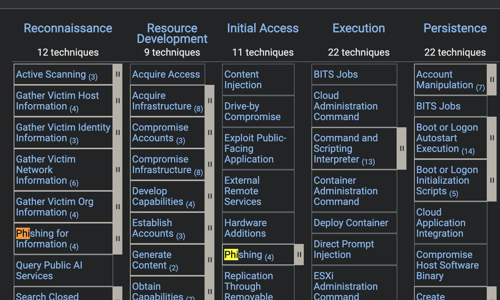

#### Q. Which ID is associated with the Create Account technique?

##### A. T1136

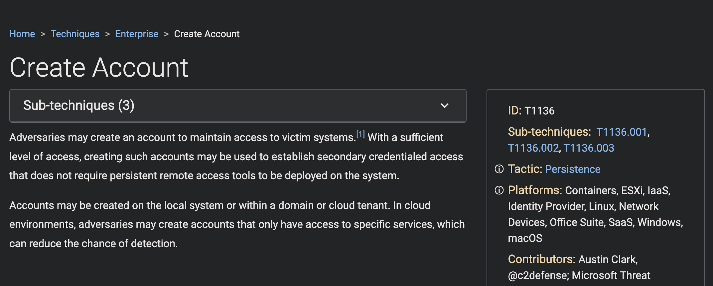

---

# 3. ATT&CK in Operation

## a. 필요성

| 이유                            | 내용                                                                                                                                                           |
| ------------------------------- | -------------------------------------------------------------------------------------------------------------------------------------------------------------- |
| **표준 언어 제공**              | 같은 행위를 여러 이름으로 부르는 혼란을 줄이고, **표준 용어와 고유 ID**로 데이터·사건 비교와 보안 커뮤니티 간 소통을 쉽게 함                                   |
| **위협 인텔리전스와 방어 연결** | 위협 보고서는 공격자가 **무엇을 했는지**는 알려주지만 탐지 방법까지는 알려주지 않음. 위협 활동을 TTP에 매핑하면 **탐지 로직, 쿼리, 플레이북**으로 바꿀 수 있음 |

## b. 활용방법

| 대상                | 목표                                   | ATT&CK 활용 방식                                                                  |
| ------------------- | -------------------------------------- | --------------------------------------------------------------------------------- |
| **CTI 팀**          | 위협 정보를 수집·분석해 보안 태세 개선 | 관찰한 위협 행위자 행동을 TTP에 매핑해 업계 전반에서 쓸 수 있는 **프로파일** 작성 |
| **SOC 분석가**      | 보안 경보 조사·분류                    | 활동을 전술·기법에 연결해 경보에 **상세한 맥락**을 주고 사건 **우선순위** 결정    |
| **탐지 엔지니어**   | 탐지 시스템 설계·개선                  | SIEM/EDR 등의 룰을 ATT&CK에 매핑해 **탐지 커버리지** 개선                         |
| **인시던트 대응팀** | 보안 사고 대응·조사                    | 사고 타임라인을 전술·기법에 매핑해 공격을 **시각화**                              |
| **레드·퍼플팀**     | 공격자 행동을 모방해 방어 테스트·개선  | 기법과 알려진 그룹의 작전에 맞춘 **에뮬레이션 계획과 훈련** 구성                  |

## c. Mapping Action (실습)

> 실습 예시: Mustang Panda (G0129)

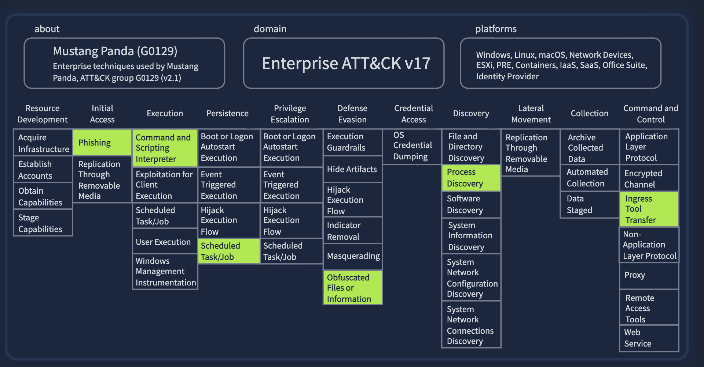

| 구분      | 내용                                                                                                                               |
| --------- | ---------------------------------------------------------------------------------------------------------------------------------- |
| 상단 박스 | 그룹 정보: Mustang Panda, G0129 도메인: Enterprise ATT&CK v17 적용 플랫폼: Windows, Linux, macOS, 네트워크 장비, 클라우드 등 |
| 가로 열   | 전술(Tactic). 공격자의 목표입니다.                                                                                                 |
| 세로 열   | 각 전술 아래의 기법(Technique)입니다.                                                                                              |
| 초록색 칸 | 이 그룹이 **실제로 사용한 것으로 확인된 기법**입니다. 회색 칸은 이 그룹과 매핑되지 않은 기법                                       |

## d. 문제

### MITRE ATT&CK 사이트 알아보기

> 1. 타이틀 - 소개

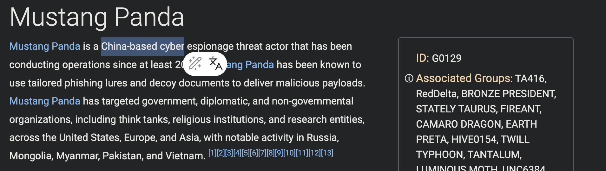

> 2. Associated Group Descriptions : 각 회사에서 부르는 공격의 별칭들을 나열

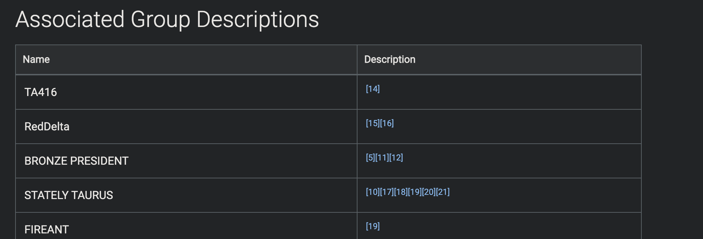

> 3. Campain: 실제로 관찰된 공격 사례

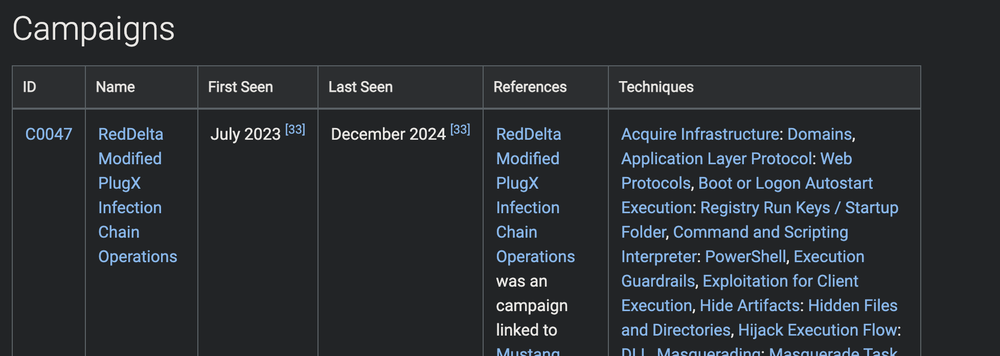

> 4. Techniques Used: 그 그룹이 사용한 ATT&CK 기법을 전부 모아 놓은 표

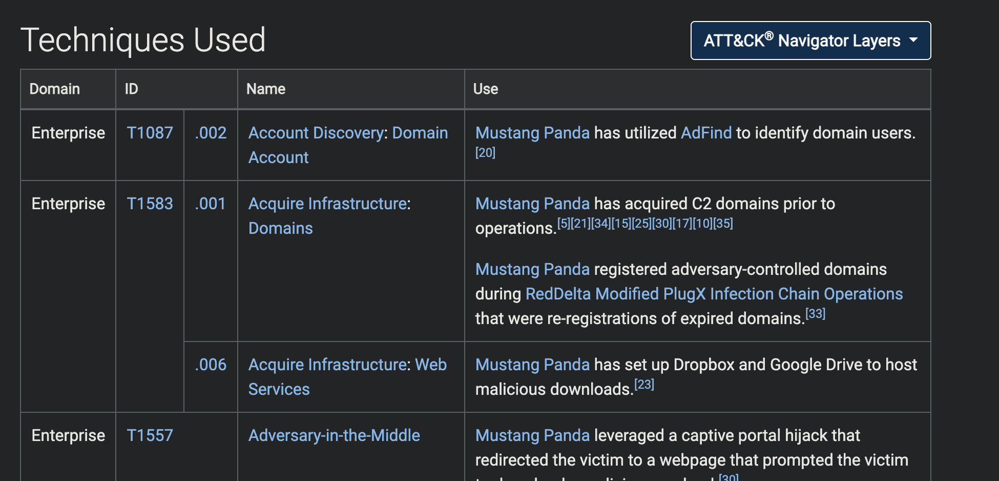

> 5. Software: 실제로 사용한 악성코드와 도구 목록

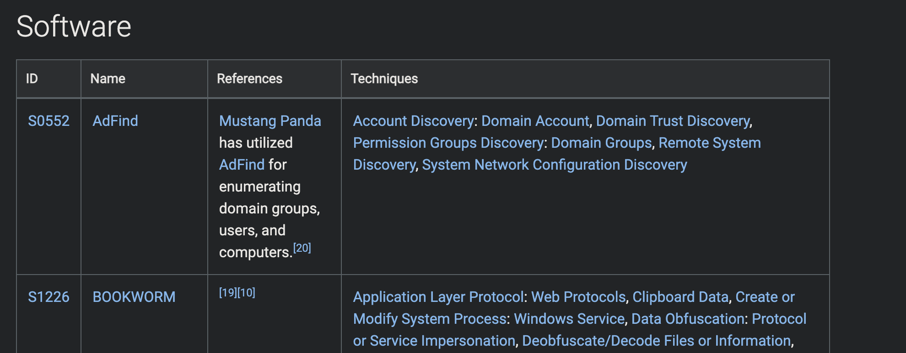

> 6. Reference: 참고자료

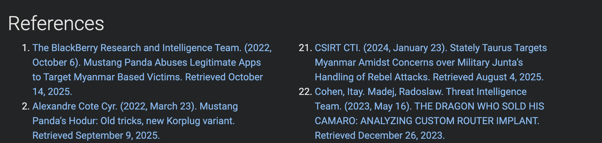

#### Q. In which country is Mustang Panda based?

> 머스탱 팬더는 어느 나라에 본사를 두고 있나요?

- A. China

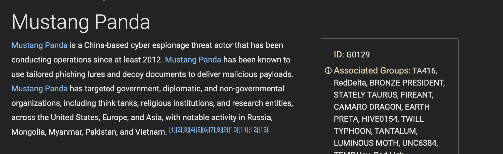

#### Q. Mustang Panda has delivered web bugs to profile its targets. Which ATT&CK technique ID covers this?

> Mustang Panda는 표적의 행동을 분석하기 위해 웹 버그를 심었습니다. 이를 다루는 ATT&CK 기법 ID는 무엇입니까?

- A. T1598 (Techniques Used 항목에 위치)

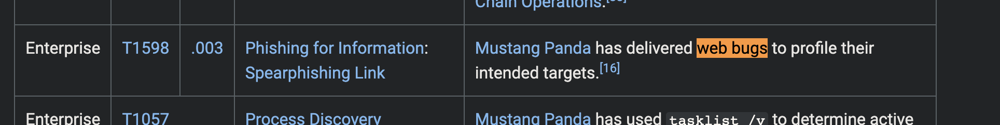

#### Q. Which software is Mustang Panda known to use for Access Token Manipulation?

- A. Cobalt Strike (Software 항목에 위치)

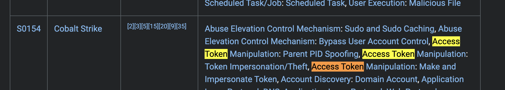

---

# 4. ATT&CK for threat intelligence

## a. 개요(실습)

> 앞서 배운 **ATT&CK로 위협 인텔리전스를 활용하는 방법**을 직접 적용해 보는 실습입니다. 특정 조직을 노리는 위협 그룹을 조사하고, 방어에 빈틈이 있는지 평가합니다.

## b. 시나리오

| 항목          | 내용                                                                                                     |
| ------------- | -------------------------------------------------------------------------------------------------------- |
| **내 역할**   | **항공 분야** 조직의 보안 분석가                                                                         |
| **조직 상황** | 인프라를 **클라우드로 이전(마이그레이션) 중**                                                            |
| **임무**      | ATT&CK로 이 분야를 노리는 **APT 그룹** 정보를 수집하고, 전술·기법을 파악해 **방어 커버리지의 공백** 평가 |

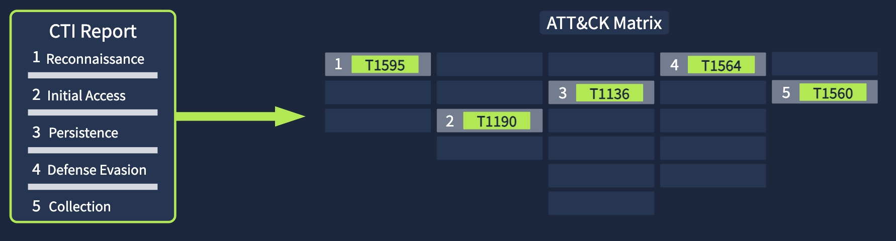

## c. 진행 방법

> 1. 그룹 선정

https://attack.mitre.org/groups/ 를 탐색, 항공 분랴를 노리는 적절한 그룹 찾기

> 2. 행동 분석

선정한 그룹의 페이지에 들어가 `Techniques Used` 와 `Software` 등을 살펴본다.

| 단계             | 할 일                                                                     | 사용 도구                          |
| ---------------- | ------------------------------------------------------------------------- | ---------------------------------- |
| **1. 그룹 선정** | ATT&CK 웹사이트의 **Groups** 섹션에서 항공 분야를 노리는 적절한 그룹 찾기 | ATT&CK Groups 페이지               |
| **2. 행동 분석** | 선택한 그룹의 활동을 **Navigator 레이어**와 **기법 페이지**로 분석        | ATT&CK Navigator, 기법 상세 페이지 |
| **3. 갭 평가**   | 그 그룹이 쓰는 기법에 비해 우리 방어에 빠진 부분이 있는지 점검            | 매핑 결과                          |

## d. 문제

#### Q. Which APT group has targeted the aviation sector and has been active since at least 2013?

> 2013년 이후로 꾸준히 활동해 왔으며 항공 산업을 표적으로 삼은 APT 그룹은 어디인가요?

- A. APT33

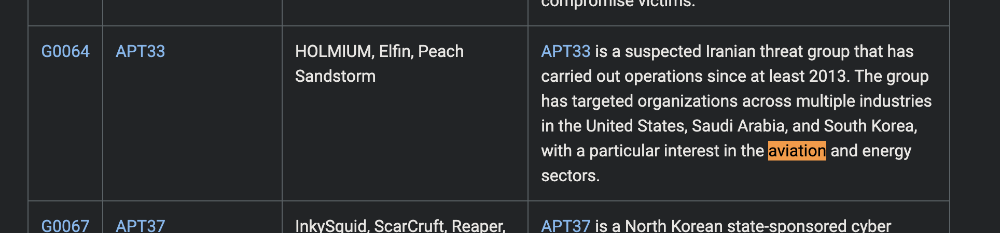

#### Q. Which ATT&CK sub-technique used by this group is a key area of concern for companies using Office 365?

> 이 그룹이 사용하는 ATT&CK 하위 기법 중, Office 365를 사용하는 기업들에게 가장 큰 우려 사항이 되는 것은 무엇입니까?

- A. Cloud Attack

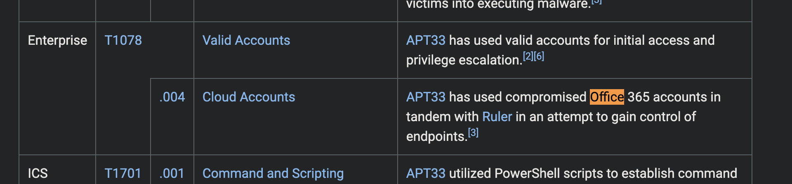

#### Q. According to ATT&CK, what tool is linked to the APT group and the sub-tec

hnique you identified?

> ATT&CK에 따르면, 귀하가 식별한 APT 그룹 및 하위 기법과 관련된 도구는 무엇입니까?

- A. Ruler ( Office 계정 관련 취약점을 이용한 소프트웨어 공격 도구)

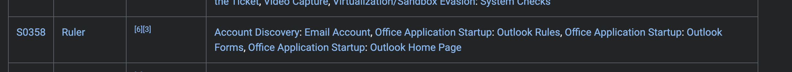

#### Q. Which mitigation strategy advises removing inactive or unused accounts to reduce exposure to this sub-technique?

> 이 하위 기법에 대한 노출 위험을 줄이기 위해 비활성 또는 미사용 계정을 삭제하도록 권장하는 완화 전략은 무엇입니까?

- A. User Account Management (Ruler > Account Discovery 클릭 > Mitigations(완화)

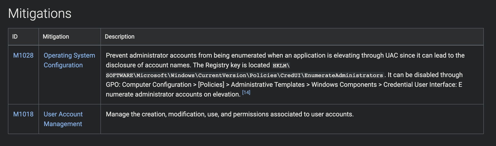

#### Q. What Detection Strategy ID would you implement to detect abused or compromised cloud accounts?

> 남용되거나 해킹당한 클라우드 계정을 탐지하기 위해 어떤 탐지 전략 ID를 구현하시겠습니까?

- A: DET0546

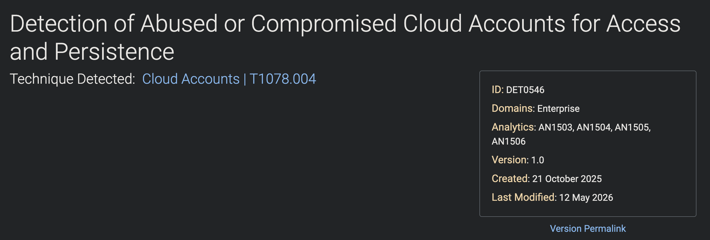

- vs `DET0386`은 **탐지하는 행위가 달라서** 오답

| ID        | 탐지 대상                                  | 의미                                                                                                          |
| --------- | ------------------------------------------ | ------------------------------------------------------------------------------------------------------------- |
| `DET0386` | API·CLI·스크립트를 통한 클라우드 계정 열거 | 공격자가 **어떤 계정이 있는지 조회**하는 행위                                                                 |
| `DET0546` | 클라우드 계정의 악용·탈취                  | 공격자가 **계정으로 로그인해 사용**하는 행위 [misp-galaxy](https://misp-galaxy.org/mitre-detection-strategy/) |

---

# 5. CAR(Cyber Analytics Repository)

## a. CAR란?

> ATT&CK이 **"공격자가 무엇을 하는가"** 라면, CAR는 **"그걸 어떻게 탐지하는가"** 예요.

- **ATT&CK 모델을 기반으로 MITRE가 만든 분석(analytic) 지식 베이스**예요. ([car.mitre.org](https://car.mitre.org/))
- 특히 **탐지 원리와 근거**가 잘 설명된, 검증된 분석을 제공하는 데 초점을 둬요.

## b. 의의

- 방어자가 **어떤 패턴을 찾아야 하는지** 알 수 있어요.
- Splunk 같은 도구의 **예시 쿼리**가 있어서 ATT&CK의 TTP를 실제 탐지 규칙으로 옮길 수 있어요.

## c. 분석 페이지 구성

예시: [CAR-2020-09-001: Scheduled Task - File Access](https://car.mitre.org/analytics/CAR-2020-09-001/)

| 항목            | 내용                                          |
| --------------- | --------------------------------------------- |
| Description     | 분석에 대한 설명                              |
| ATT&CK 참조     | 관련 전술(Tactic)과 기법(Technique)           |
| Implementations | 의사코드, Splunk 쿼리, LogPoint 검색 예시     |
| Unit Tests      | 분석이 의도대로 작동하는지 검증 (일부 분석만) |

해당 페이지를 통해 본 의사코드와 Splunk 쿼리를 **참고해서 자기 환경에 맞게 탐지 규칙을 만드는 것**이 목적

## d. ATT&CK Navigator 레이어

> **ATT&CK Navigator**는 ATT&CK 매트릭스(전술·기법 표)에 **색칠하고 메모할 수 있는 웹 도구**예요. **레이어(layer)** 는 그 위에 덮는 **색칠 정보 한 벌**이고, JSON 파일로 저장해요.

- CAR 전용 레이어가 있어서, **CAR가 어떤 기법을 다루는지** ATT&CK 매트릭스 위에서 볼 수 있어요.

## e. 문제

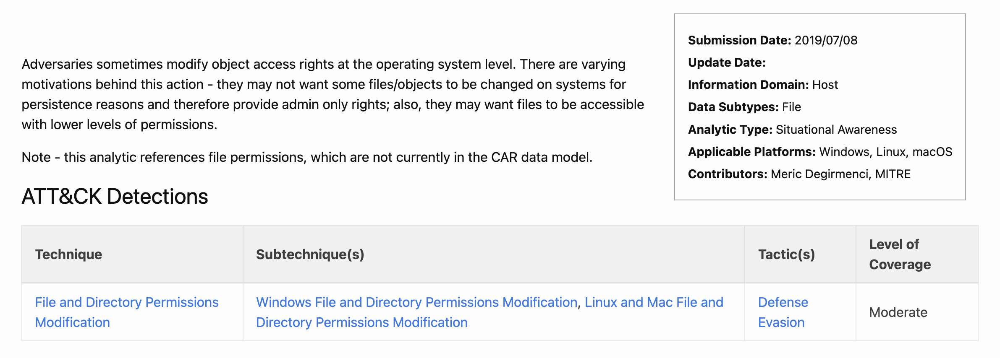

#### Q. Which ATT&CK Tactic is associated with [CAR-2019-07-001](https://car.mitre.org/analytics/CAR-2019-07-001/)?

> CAR-2019-07-001과 관련된 ATT&CK 전술은 무엇입니까?

- A: Defense Evasion

#### Q. What is the Analytic Type for Access Permission Modification?

> 접근 권한 수정의 분석 유형은 무엇입니까?

- A: Situational Awareness

---

# 6. D3FEND Framework

## a. ATT&CK vs D3FEND

| 프레임워크 | 관점   | 알 수 있는 것                |
| ---------- | ------ | ---------------------------- |
| ATT&CK     | 공격자 | 공격이 **어떻게 일어나는가** |
| D3FEND     | 방어자 | 공격을 **어떻게 막는가**     |

## b. D3FEND란?

- **Detection, Denial, and Disruption Framework Empowering Network Defense**의 약자예요.
- **방어 기법을 체계적으로 정리한** 프레임워크예요.
- 보안 통제가 어떻게 작동하는지 설명하는 **공통 언어**를 만들어요.

## c. [D3FEND 매트릭스](https://d3fend.mitre.org/)

**7개 전술**로 나뉘고, 각 전술 아래에 기법과 ID가 있어요.

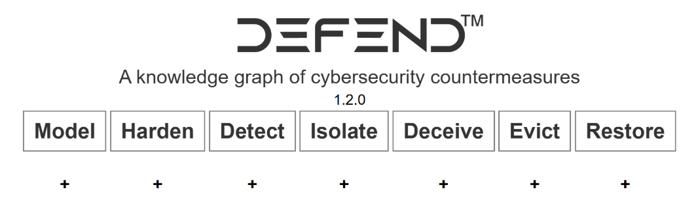

| 전술    | 의미                      |
| ------- | ------------------------- |
| Model   | 자산과 시스템 구조 파악   |
| Harden  | 공격받기 어렵게 강화      |
| Detect  | 악성 활동 탐지            |
| Isolate | 격리해서 확산 차단        |
| Deceive | 가짜 자원으로 공격자 유인 |
| Evict   | 공격자와 악성 요소 제거   |
| Restore | 정상 상태로 복구          |

## d. 문제

#### Q. Which sub-technique of [User Behavior Analysis](https://d3fend.mitre.org/technique/d3f:UserBehaviorAnalysis/) would you use to analyze the geolocation data of user logon attempts?

> 사용자 로그인 시도의 위치 정보를 분석하기 위해 사용자 행동 분석의 어떤 하위 기법을 사용하시겠습니까?

- A: User Geolocation Logon Pattern Analysis

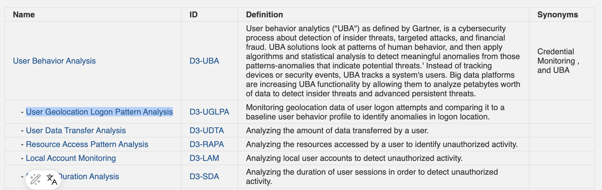

#### Q. Which digital artifact does this sub-technique rely on analyzing?

> 이 하위 기법은 어떤 디지털 유물의 분석에 의존합니까?

- A: Network Traffic

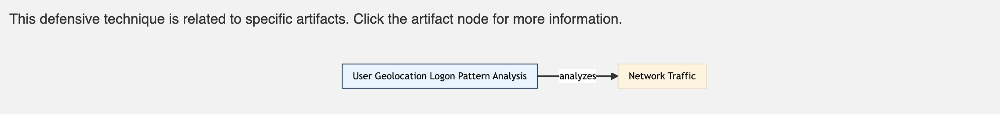

원하는 정보를 보고싶을 땐 탭 창을 한 번 끄고 뒤로가기를 해야 페이지 내용이 갱신되는 것 같음

# 7. MITRE 기타 프로젝트

## a. 개요

> 사이버 보안 전문가가 **실력을 키우고, 방어를 테스트하고, 공격자에 대응**하도록 돕는 프로젝트들이에요.

## b. 공격 모사(Emulation) 관련

| 이름                                                                                         | 정체                      | 핵심 내용                                                  |
| -------------------------------------------------------------------------------------------- | ------------------------- | ---------------------------------------------------------- |
| [Adversary Emulation Library](https://ctid.mitre.org/resources/adversary-emulation-library/) | 무료 **모사 계획 모음**   | 알려진 위협 그룹의 실제 공격을 따라 하는 **단계별 가이드** |
| [Caldera](https://caldera.mitre.org/)                                                        | **자동화** 공격 모사 도구 | ATT&CK 기반으로 공격자 행동을 시뮬레이션                   |

- 라이브러리는 주로 **CTID**(Center for Threat-Informed Defense)가 관리하고 기여해요.
- Caldera로는 통제된 환경에서 **탐지 방법 평가**와 **사고 대응 훈련**을 할 수 있어요.
- Caldera는 공격과 방어를 모두 지원해서 **레드팀·블루팀 훈련**에 유용해요.

**차이**

- Adversary Emulation Library는 **"무엇을 어떤 순서로 따라 할지" 적은 계획서**
- Caldera는 **공격 행동을 자동으로 실행하는 도구**

## c. 새로운 프레임워크

| 이름                                | 설명                                                                                        | 대상                                                 |
| ----------------------------------- | ------------------------------------------------------------------------------------------- | ---------------------------------------------------- |
| [AADAPT](https://aadapt.mitre.org/) | 자체 매트릭스가 있고 **ATT&CK과 비슷한 구조**예요. 디지털 자산 위협의 이해와 완화를 도와요. | **디지털 자산** (블록체인, 스마트 계약, 디지털 지갑) |
| [ATLAS](https://atlas.mitre.org/)   | 자체 매트릭스, AI에 대한 **실제 공격 기법, 취약점, 완화책**을 정리해요.                     | **AI·머신러닝** 시스템                               |

## d. 문제

#### Q. What technique ID is associated with [Scrape Blockchain Data](https://aadapt.mitre.org/techniques/ADT3025) in the AADAPT framework?

- A: ADT3025

#### Q. Which tactic does [LLM Prompt Obfuscation](https://atlas.mitre.org/techniques/AML.T0068) belong to in the ATLAS framework?

- A: Defense Evasion
